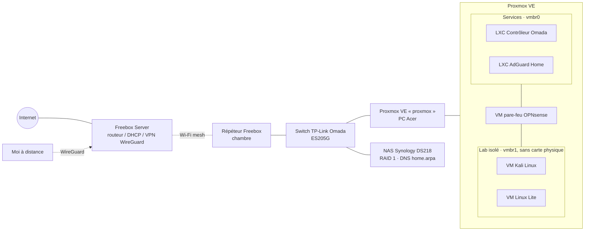

# Homelab — Mam III Jobb

Infrastructure personnelle auto-hébergée qui me sert de terrain d'entraînement en **réseau**, **virtualisation** et **sécurité**.
Chaque brique est documentée avec **le pourquoi des choix**, pas seulement le comment.

> Ingénieur cybersécurité — sécurité réseau, gestion des vulnérabilités, intégration.
> [LinkedIn](https://www.linkedin.com/in/jobb-mam-iii/) · Contact : voir CV

---

## Vue d'ensemble

### Segmentation du lab

Les VM de test (dont Kali) sont sur un réseau isolé (`vmbr1`), sans carte physique : la seule sortie passe par le pare-feu OPNsense.

| Flux | Règle | Pourquoi |
|---|---|---|
| Lab → Internet | Autorisé, journalisé | Mises à jour et téléchargement d'outils |
| Lab → réseau maison | **Bloqué** | Un scan ou un exploit lancé par erreur ne touche jamais les appareils de la famille |
| Poste d'admin → lab | Autorisé | Administrer les VM depuis mon PC |
| Reste | Refusé par défaut | Moindre privilège : tout ce qui n'est pas explicitement autorisé est interdit |

## Les briques

| Domaine | Ce qui tourne | Doc |
|---|---|---|
| Virtualisation | Proxmox VE, VM + conteneurs LXC | [docs/01-virtualisation.md](docs/01-virtualisation.md) |
| Réseau | Switch Omada + contrôleur en LXC, pare-feu OPNsense, lab isolé | [docs/02-reseau.md](docs/02-reseau.md) |
| DNS | Zone locale `home.arpa` sur Synology + filtrage AdGuard Home | [docs/03-dns.md](docs/03-dns.md) |
| Accès distant | VPN WireGuard (Freebox) | [docs/04-acces-distant.md](docs/04-acces-distant.md) |
| Stockage & sauvegarde | NAS Synology RAID 1, sauvegarde versionnée PC → NAS | [docs/05-stockage-sauvegarde.md](docs/05-stockage-sauvegarde.md) |
| Déploiement applicatif (réalisé, conteneur retiré depuis) | Appli web Python en LXC, systemd, durcissement, Tailscale | [docs/06-deploiement-appli-web.md](docs/06-deploiement-appli-web.md) |
| Identité cloud | Tenant de test Microsoft 365 / Entra ID | [docs/07-m365-entra-id.md](docs/07-m365-entra-id.md) |

## Feuille de route

- [ ] Segmenter : VLAN dédiés (lab offensif / services / maison) via le switch Omada
- [ ] Accès conditionnel Entra ID (préparation SC-300)
- [ ] Centraliser les logs (SIEM léger) des services du lab
- [ ] Installer XCP-ng (sur l'Intel NUC) pour comparer avec Proxmox

## Règles de publication

Ce dépôt est public : **aucun secret** (mots de passe, clés, tokens), **aucune IP publique**, **aucun identifiant de compte** ni nom de tailnet.
Les adresses en `192.168.x.x` sont des adresses privées, non joignables depuis Internet.
