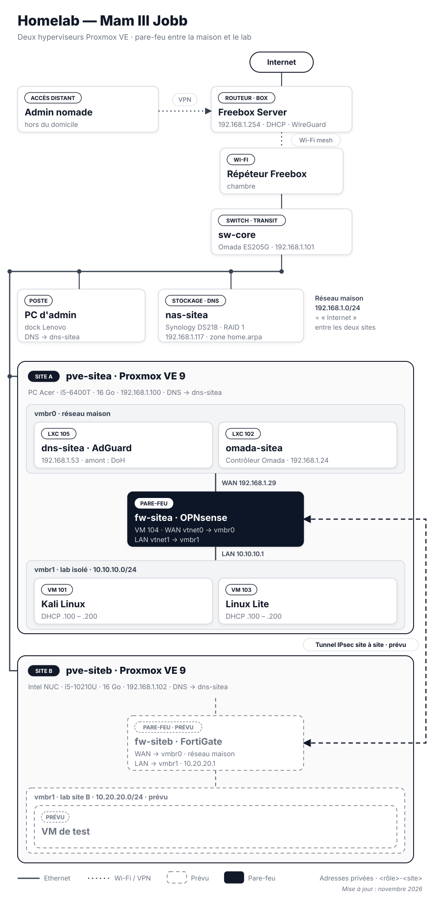

# Homelab — Mam III Jobb

Infrastructure personnelle auto-hébergée qui me sert de terrain d'entraînement en **réseau**, **virtualisation** et **sécurité**.
Chaque brique est documentée avec **le pourquoi des choix**, pas seulement le comment.

> Ingénieur cybersécurité — sécurité réseau, gestion des vulnérabilités, intégration.
> [LinkedIn](https://www.linkedin.com/in/jobb-mam-iii/) · Contact : voir CV

---

## Vue d'ensemble

Les éléments en pointillés (FortiGate, lab du site B, tunnel IPsec) sont **prévus**, pas encore en place. Le schéma est généré par [scripts/gen_schema.py](scripts/gen_schema.py).

Les flèches « flux DNS » montrent le **chemin d'une requête DNS** : le PC interroge AdGuard ; si le nom se termine par `home.arpa`, AdGuard transmet au NAS (serveur de la zone locale) ; sinon, il interroge Cloudflare ou Quad9 en DNS over HTTPS (requête chiffrée, invisible pour la box et le FAI). Détail dans [docs/03-dns.md](docs/03-dns.md).

### Plan d'adressage

| Réseau | Plage | Passerelle | Rôle |
|---|---|---|---|
| Maison (`vmbr0`) | 192.168.1.0/24 | Freebox 192.168.1.254 | Services, administration, appareils de la maison |
| Lab site A (`vmbr1` de pve-sitea) | 10.10.10.0/24 | OPNsense 10.10.10.1 | VM de test isolées derrière le pare-feu. `.2–.99` : IP fixes · `.100–.200` : DHCP d'OPNsense |
| Lab site B (NUC, prévu) | 10.20.20.0/24 | FortiGate 10.20.20.1 | Second site relié au lab par VPN IPsec |

Pourquoi `10.x` pour les labs plutôt que `192.168.x` : les box et les Wi-Fi publics utilisent presque tous `192.168.0.x` ou `192.168.1.x`. Un lab en `10.x` évite les chevauchements le jour où l'on s'y connecte en VPN depuis un autre réseau, et deux sites reliés en IPsec doivent avoir des plages distinctes. Le 2e octet indique le site (`10.10` = A, `10.20` = B).

Pourquoi une plage différente par réseau : si deux réseaux utilisaient 192.168.1.0/24, le pare-feu ne pourrait pas savoir de quel côté envoyer un paquet. Deux plages distinctes = un routage et des règles sans ambiguïté.

### Deux sites dans une même pièce : underlay et overlay

Les deux hyperviseurs sont physiquement sur le même switch. Ce qui est simulé, c'est la partie logique :
- **site A** = ce qui est derrière OPNsense (`10.10.10.0/24`), **site B** = ce qui sera derrière le FortiGate (`10.20.20.0/24`) ;
- le **réseau maison** (`192.168.1.0/24`) joue le rôle d'**Internet** entre les deux : c'est l'**underlay**, le réseau de transport sur lequel sont branchés les WAN des deux pare-feux ;
- le **tunnel IPsec** est l'**overlay** : les deux labs ne se joignent que par lui, jamais directement, comme un siège et une agence reliés à travers Internet.

### Convention de nommage

Chaque équipement d'infrastructure suit le format **`<rôle>-<site>`** : le nom dit ce qu'est la machine et où elle se trouve. L'emplacement physique et le matériel vont dans le commentaire de la réservation DHCP, pas dans le nom.

| Nom | Rôle | IP |
|---|---|---|
| `pve-sitea` | Hyperviseur Proxmox VE, site A (PC Acer) | 192.168.1.100 |
| `pve-siteb` | Hyperviseur Proxmox VE, site B (Intel NUC) | 192.168.1.102 |
| `fw-sitea` | Pare-feu OPNsense, site A (interface WAN) | 192.168.1.29 |
| `fw-siteb` | Pare-feu FortiGate, site B (prévu) | — |
| `sw-core` | Switch Omada ES205G — transit commun aux deux sites, d'où `core` et non `sitea` | 192.168.1.101 |
| `nas-sitea` | NAS Synology DS218 | 192.168.1.117 |
| `dns-sitea` | AdGuard Home (LXC 105) | 192.168.1.53 |
| `omada-sitea` | Contrôleur Omada (LXC 102) | 192.168.1.24 |

Chaque adresse est réservée sur la Freebox (adresse MAC → IP) : la liste des réservations sert d'inventaire des IP fixes.
Le nœud Proxmox du site A s'appelle encore `proxmox` en interne : son renommage demande de déplacer les configurations des VM (`/etc/pve/nodes/<nom>/`) et sera fait à part, après sauvegarde.

### Segmentation du lab

Les VM de test (dont Kali) sont sur un réseau isolé (`vmbr1`), sans carte physique : la seule sortie passe par le pare-feu OPNsense. Preuve concrète : un `ping 1.1.1.1` depuis Kali revient avec un TTL inférieur de 1 à celui obtenu depuis OPNsense — un routeur de plus sur le chemin, le pare-feu.

| Flux | Règle | État | Pourquoi |
|---|---|---|---|
| Internet / maison → pare-feu (WAN) | Bloqué par défaut, réseaux privés et bogons rejetés | En place | Une interface d'administration de pare-feu ne doit jamais être exposée côté WAN |
| Lab → Internet | Autorisé (NAT) | En place | Mises à jour et téléchargement d'outils |
| Lab → réseau maison | **Bloqué** | À faire — la règle LAN par défaut d'OPNsense autorise encore tout | Un scan ou un exploit lancé par erreur ne doit jamais toucher les appareils de la famille |
| PC d'admin → interface OPNsense | Autorisé depuis une seule IP, port 443 uniquement | À faire | Administrer sans passer par la console, en limitant la source et le port |
| Reste | Refusé par défaut | En place | Moindre privilège : tout ce qui n'est pas explicitement autorisé est interdit |

## Les briques

| Domaine | Ce qui tourne | Doc |
|---|---|---|
| Virtualisation | Deux hyperviseurs Proxmox VE indépendants (site A et site B), VM + conteneurs LXC | [docs/01-virtualisation.md](docs/01-virtualisation.md) |
| Réseau | Switch Omada + contrôleur en LXC, pare-feu OPNsense, lab isolé, réservations DHCP, IPv6 maîtrisé (SLAAC désactivé) | [docs/02-reseau.md](docs/02-reseau.md) |
| DNS | Zone locale `home.arpa` sur Synology + filtrage AdGuard Home | [docs/03-dns.md](docs/03-dns.md) |
| Accès distant | VPN WireGuard (Freebox) | [docs/04-acces-distant.md](docs/04-acces-distant.md) |
| Stockage & sauvegarde | NAS Synology RAID 1 durci (2FA, comptes par défaut désactivés), instantanés Btrfs quotidiens, sauvegarde versionnée PC → NAS | [docs/05-stockage-sauvegarde.md](docs/05-stockage-sauvegarde.md) |
| Déploiement applicatif (réalisé, conteneur retiré depuis) | Appli web Python en LXC, systemd, durcissement, Tailscale | [docs/06-deploiement-appli-web.md](docs/06-deploiement-appli-web.md) |
| Identité cloud | Tenant de test Microsoft 365 / Entra ID | [docs/07-m365-entra-id.md](docs/07-m365-entra-id.md) |

## Feuille de route

Priorité : tout ce qui tourne autour du pare-feu et de l'intégration sécurité réseau.

- [x] Pare-feu OPNsense (site A) : installation, interfaces WAN/LAN, DHCP du lab, mise à jour
- [x] Intel NUC en « site B » : Proxmox VE installé et à jour (`pve-siteb`)
- [ ] Règles de filtrage du lab : blocage lab → maison, accès d'administration limité au PC d'admin
- [ ] FortiGate en VM sur le NUC (licence d'évaluation), réseau interne 10.20.20.0/24 — préparation Fortinet NSE4
- [ ] VPN IPsec site à site entre OPNsense (site A, 10.10.10.0/24) et FortiGate (site B, 10.20.20.0/24) : interopérabilité entre deux constructeurs, comme chez un client siège + agence
- [ ] IDS/IPS Suricata sur OPNsense, testé avec des scans et attaques depuis Kali
- [ ] Envoi des logs du pare-feu (syslog) vers le NAS Synology (Log Center) pour les conserver hors du pare-feu
- [ ] Scan de vulnérabilités du lab avec Nessus Essentials
- [ ] Segmentation par VLAN (lab / services / maison) via le switch Omada
- [ ] WAN du site B dans un VLAN séparé : les deux pare-feux ne partagent plus le même réseau et sont reliés par un routage, encore plus proche d'un vrai lien entre deux sites (le switch ES205G ne fait que du niveau 2 : le routeur entre les deux VLAN reste à choisir)
- [ ] AdGuard Home comme DNS pour tout le réseau
- [ ] Copie de sauvegarde hors site (règle 3-2-1)
- [ ] Accès conditionnel Entra ID (préparation SC-300)

## Règles de publication

Ce dépôt est public : **aucun secret** (mots de passe, clés, tokens), **aucune IP publique**, **aucun identifiant de compte** ni nom de tailnet.
Les adresses en `192.168.x.x` sont des adresses privées, non joignables depuis Internet.
