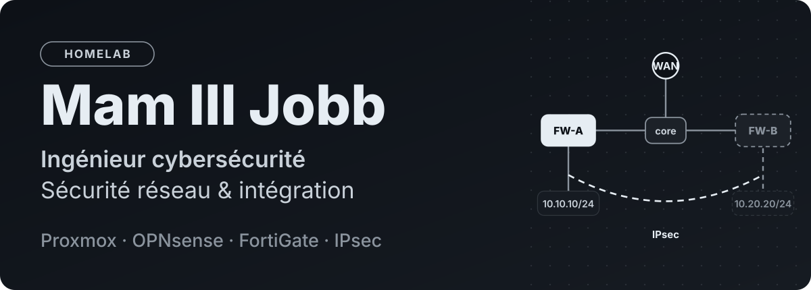
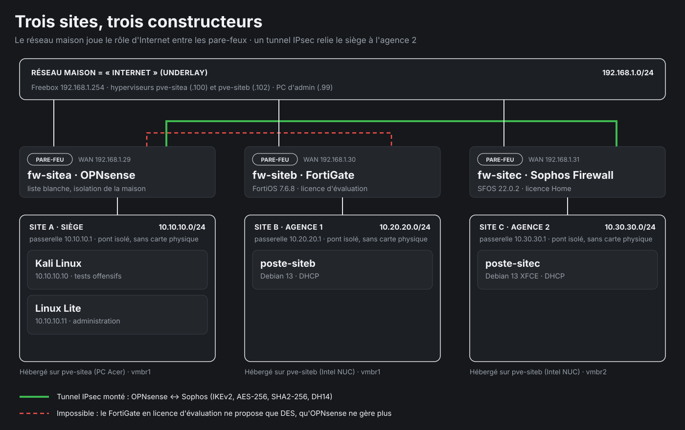
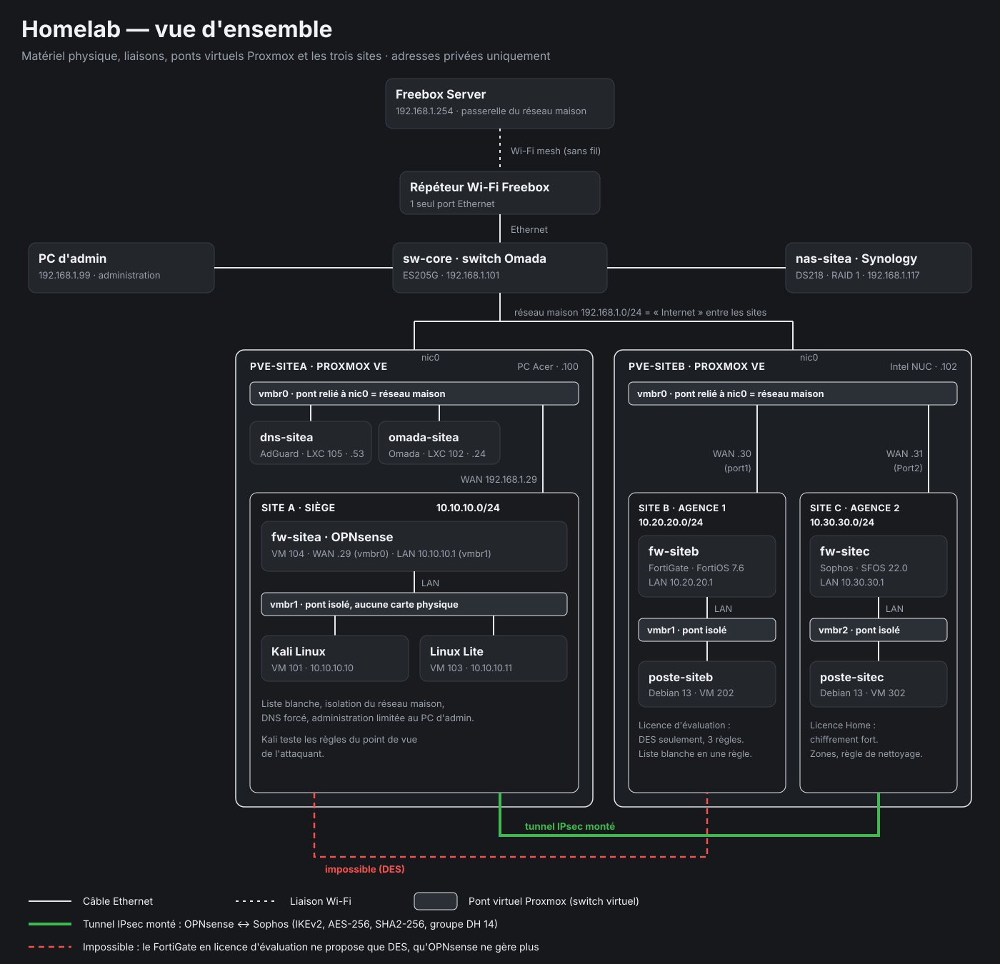

 

Infrastructure personnelle qui me sert de terrain d'entraînement en **réseau**, **virtualisation** et **sécurité**. 
Chaque brique est documentée avec **le pourquoi des choix**, pas seulement le comment.

[LinkedIn](https://www.linkedin.com/in/jobb-mam-iii/) · [Documentation](docs/README.md) · [Feuille de route](#feuille-de-route)

---

## Sommaire

- [Vue d'ensemble](#vue-densemble)
- [Comment le lab a grandi](#comment-le-lab-a-grandi)
- [Pourquoi ce lab](#pourquoi-ce-lab)
- [État du lab](#état-du-lab)
- [Plan d'adressage](#plan-dadressage)
- [Segmentation du lab](#segmentation-du-lab)
- [Feuille de route](#feuille-de-route)

📚 **Toute la documentation, classée en deux parcours avec un temps de lecture par fiche : [docs/README.md](docs/README.md).**

## Vue d'ensemble

**Vue logique :** trois sites, trois constructeurs. Le réseau maison joue le rôle d'Internet entre les pare-feux.

**Vue détaillée :** le matériel physique, ce que chaque hyperviseur héberge, et le rôle de chaque site.

**Chemin d'une requête DNS** : le PC et les deux hyperviseurs interrogent AdGuard ; si le nom se termine par `home.arpa`, AdGuard transmet au NAS (serveur de la zone locale) ; sinon, il interroge Cloudflare ou Quad9 en DNS over HTTPS (requête chiffrée, invisible pour la box et le FAI). Détail dans [docs/03-dns.md](docs/03-dns.md).

## Comment le lab a grandi

Je n'ai rien acheté d'un coup : chaque brique est arrivée quand j'en ai eu besoin.

1. **VirtualBox sur mon PC perso**, pour mes premières VM de test.
2. **Un PC Acer sous Proxmox VE**, pour faire tourner les VM en continu (Kali et quelques machines de test).
3. **Un NAS Synology en RAID 1**, pour rapatrier mes données en local plutôt que de payer des abonnements cloud de plus en plus chers. Il héberge aussi la zone DNS locale `home.arpa`. Étape suivante : une copie hors site (règle 3-2-1).
4. **Un switch manageable Omada** : le lab est branché sur un répéteur Freebox qui n'a qu'un port Ethernet, pour quatre machines. Le switch est piloté par son contrôleur, installé dans un conteneur.
5. **Un DNS filtrant** : AdGuard Home en conteneur, qui transmet les noms `home.arpa` au NAS et chiffre le reste en DNS over HTTPS.
6. **Un pare-feu OPNsense** : jusque-là, Kali était sur le même réseau que les appareils de la maison. Le lab est maintenant isolé, et sa seule sortie passe par le pare-feu.
7. **Un deuxième site** : un Intel NUC sous Proxmox, avec un FortiGate. Sa licence d'évaluation gratuite s'est révélée incapable de monter un tunnel avec OPNsense : elle ne propose que DES, qu'OPNsense ne gère plus.
8. **Un troisième site** : Sophos Firewall Home sur le même NUC, relié au siège par un tunnel IPsec. Deux constructeurs différents qui s'entendent sur IKEv2, AES-256 et le groupe DH 14.
9. **Du trafic dans le tunnel** : des règles en moindre privilège des deux côtés, Kali administre le poste de l'agence en SSH, et rien d'autre ne passe. En lisant les journaux, j'ai trouvé qu'une règle « web vers Internet » ouvrait aussi l'agence : *any* couvre plus que ce qu'on croit.

Chaque étape est documentée dans `docs/`, avec ce qui a coincé et comment je l'ai réglé.

## Pourquoi ce lab

Ce lab me sert à m'entraîner sur des cas concrets d'entreprise : isoler un réseau à risque, relier des sites équipés de pare-feux de constructeurs différents, sécuriser l'accès distant, puis vérifier depuis Kali que les règles tiennent vraiment.

Chaque étape répond au besoin d'une entreprise fictive :

| Besoin de l'entreprise | Ce que je fais dans le lab | État |
| --- | --- | --- |
| « Ce réseau à risque ne doit pas toucher le reste » | Isolation du lab derrière OPNsense ([fiche 08](docs/08-filtrage-pare-feu.md)) | ✅ Fait |
| « Il faut relier le siège et les agences » | Tunnel IPsec OPNsense (siège) ↔ Sophos (agence 2) ; le FortiGate (agence 1) en est incapable en licence d'évaluation ([fiche 13](docs/13-tunnel-ipsec.md)) | ✅ Tunnel monté, règles du tunnel en cours |
| « Nos salariés télétravaillent » | VPN d'accès distant avec double authentification (FortiClient) | ⚠️ Limité par la licence d'évaluation (VPN SSL impossible, IPsec à tester) |
| « On veut contrôler l'usage du web » | Filtrage web et inspection SSL : impossible sur le FortiGate en licence d'évaluation, possible sur Sophos Home | 🔜 Prévu (site C) |
| « Prouvez-moi que ça protège vraiment » | Attaques et scans depuis Kali, détection avec Suricata | 🔜 Prévu |

La licence d'évaluation gratuite du FortiGate n'autorise que le chiffrement DES et limite la VM à 3 interfaces, 3 règles et 3 routes. Les besoins qu'elle ne permet pas de couvrir sont marqués comme tels plutôt que retirés : chez un client, la licence payante lève ces limites. Pour le tunnel, un troisième site protégé par Sophos Firewall Home (gratuit, chiffrement fort) a pris le relais.

Kali ne sert pas à faire du pentest : elle sert à tester mes propres règles du point de vue de l'attaquant.

## État du lab

| Brique (lien vers la fiche) | État | Ce qui tourne |
|---|---|---|
| [01 · Virtualisation](docs/01-virtualisation.md) | ✅ | Deux hyperviseurs Proxmox VE : `pve-sitea` (PC Acer) et `pve-siteb` (Intel NUC, sites B et C), VM et conteneurs LXC |
| [02 · Réseau](docs/02-reseau.md) | ✅ | Switch Omada et son contrôleur en LXC, pare-feu OPNsense (`fw-sitea`) : DHCP et NAT du lab, IPv6 maîtrisé (SLAAC désactivé) |
| [03 · DNS](docs/03-dns.md) | ✅ | AdGuard Home (filtrage, DNS over HTTPS) et zone locale `home.arpa` sur le Synology |
| [04 · Accès distant](docs/04-acces-distant.md) | ✅ | VPN WireGuard (Freebox) pour l'administration |
| [05 · Stockage et sauvegarde](docs/05-stockage-sauvegarde.md) | ✅ | NAS Synology RAID 1 durci (2FA, comptes par défaut désactivés), instantanés Btrfs quotidiens, sauvegarde versionnée PC → NAS |
| [06 · Déploiement applicatif](docs/06-deploiement-appli-web.md) | ✅ | Appli web Python en LXC, systemd, durcissement, Tailscale (conteneur retiré depuis) |
| [07 · Identité cloud](docs/07-m365-entra-id.md) | 🧪 Test | Tenant de test Microsoft 365 / Entra ID |
| [08 · Isolation du lab](docs/08-filtrage-pare-feu.md) | ✅ | Lab → maison refusé (Reject), testé et vérifié dans les logs |
| [09 · Accès d'administration](docs/09-acces-admin.md) | ✅ | Interface d'OPNsense joignable depuis le seul PC d'admin, en HTTPS |
| [10 · Liste blanche](docs/10-liste-blanche.md) | ✅ | Le lab ne sort que pour le web, le NTP, le ping et le DNS via OPNsense ; tout le reste est refusé et journalisé |
| [11 · Pare-feu du site B](docs/11-fortigate-site-b.md) | ✅ | FortiGate (`fw-siteb`, FortiOS 7.6.8, licence d'évaluation) : CLI, `allowaccess`, *trusted host*, DHCP, DNS, liste blanche en une règle |
| [12 · Pare-feu du site C](docs/12-sophos-site-c.md) | ✅ | Sophos Firewall Home (`fw-sitec`, SFOS 22.0.2) : zones, ACL des services, liste blanche, règle de nettoyage |
| [13 · Liaison entre les sites](docs/13-tunnel-ipsec.md) | ✅ | Tunnel IPsec IKEv2 OPNsense ↔ Sophos (AES-256, DH14) ; OPNsense ↔ FortiGate impossible (DES seul) |
| [14 · Règles dans le tunnel](docs/14-regles-tunnel.md) | ✅ | Kali (siège) → poste-sitec (agence 2) en SSH et ping uniquement, testé dans les deux sens ; faille « any » trouvée dans les journaux et corrigée |
| [Inventaire IP](docs/inventaire-ip.md) | ✅ | Toutes les adresses fixes, réseau par réseau |

## Plan d'adressage

| Réseau | Plage | Passerelle | Rôle |
|---|---|---|---|
| Maison (`vmbr0`) | 192.168.1.0/24 | Freebox 192.168.1.254 | Services, administration, appareils de la maison |
| Lab site A (`vmbr1` de pve-sitea) | 10.10.10.0/24 | OPNsense 10.10.10.1 | VM de test isolées derrière le pare-feu. `.2–.99` : IP fixes (Kali `.10`, Linux Lite `.11`, réservées dans Dnsmasq) · `.100–.200` : DHCP d'OPNsense |
| Lab site B (`vmbr1` de pve-siteb) | 10.20.20.0/24 | FortiGate 10.20.20.1 | Agence 1. `.100–.200` : DHCP du FortiGate |
| Lab site C (`vmbr2` de pve-siteb) | 10.30.30.0/24 | Sophos 10.30.30.1 | Agence 2, reliée au siège par le tunnel IPsec. `.100–.200` : DHCP de Sophos |

Inventaire complet, machine par machine : [docs/inventaire-ip.md](docs/inventaire-ip.md).

<b>Pourquoi des plages en 10.x et une plage par réseau</b>

Pourquoi `10.x` pour les labs plutôt que `192.168.x` : les box et les Wi-Fi publics utilisent presque tous `192.168.0.x` ou `192.168.1.x`. Un lab en `10.x` évite les chevauchements le jour où l'on s'y connecte en VPN depuis un autre réseau, et deux sites reliés en IPsec doivent avoir des plages distinctes. Le 2e octet indique le site (`10.10` = A, `10.20` = B, `10.30` = C).

Pourquoi une plage différente par réseau : si deux réseaux utilisaient 192.168.1.0/24, le pare-feu ne pourrait pas savoir de quel côté envoyer un paquet. Deux plages distinctes = un routage et des règles sans ambiguïté.

<b>Deux sites dans une même pièce : underlay et overlay</b>

Les deux hyperviseurs sont physiquement sur le même switch. Ce qui est simulé, c'est la partie logique :
- **site A** = ce qui est derrière OPNsense (`10.10.10.0/24`), **site B** = derrière le FortiGate (`10.20.20.0/24`), **site C** = derrière Sophos (`10.30.30.0/24`) ; les sites B et C partagent le NUC, chacun avec son propre pont isolé ;
- le **réseau maison** (`192.168.1.0/24`) joue le rôle d'**Internet** entre les deux : c'est l'**underlay**, le réseau de transport sur lequel sont branchés les WAN des trois pare-feux ;
- le **tunnel IPsec** est l'**overlay** : les deux labs ne se joignent que par lui, jamais directement, comme un siège et une agence reliés à travers Internet.

<b>Convention de nommage &lt;rôle&gt;-&lt;site&gt;</b>

Chaque équipement d'infrastructure suit le format **`<rôle>-<site>`** : le nom dit ce qu'est la machine et où elle se trouve. L'emplacement physique et le matériel vont dans le commentaire de la réservation DHCP, pas dans le nom.

| Nom | Rôle | IP |
|---|---|---|
| `pve-sitea` | Hyperviseur Proxmox VE, site A (PC Acer) | 192.168.1.100 |
| `pve-siteb` | Hyperviseur Proxmox VE, sites B et C (Intel NUC) | 192.168.1.102 |
| `fw-sitea` | Pare-feu OPNsense, site A (interface WAN) | 192.168.1.29 |
| `fw-siteb` | Pare-feu FortiGate, site B (port1, WAN) | 192.168.1.30 |
| `fw-sitec` | Pare-feu Sophos, site C (Port2, WAN) | 192.168.1.31 |
| `sw-core` | Switch Omada ES205G — transit commun aux deux sites, d'où `core` et non `sitea` | 192.168.1.101 |
| `nas-sitea` | NAS Synology DS218 | 192.168.1.117 |
| `dns-sitea` | AdGuard Home (LXC 105) | 192.168.1.53 |
| `omada-sitea` | Contrôleur Omada (LXC 102) | 192.168.1.24 |

Chaque adresse est réservée sur la Freebox (adresse MAC → IP) : la liste des réservations sert d'inventaire des IP fixes.
Le nœud Proxmox du site A s'appelle encore `proxmox` en interne : son renommage demande de déplacer les configurations des VM (`/etc/pve/nodes/<nom>/`) et sera fait à part, après sauvegarde.

## Segmentation du lab

Les VM de test (dont Kali) sont sur un réseau isolé (`vmbr1`), sans carte physique : la seule sortie passe par le pare-feu OPNsense. Preuve concrète : un `ping 1.1.1.1` depuis Kali revient avec un TTL inférieur de 1 à celui obtenu depuis OPNsense — un routeur de plus sur le chemin, le pare-feu.

| Flux | Règle | Détail | Pourquoi |
|---|---|---|---|
| Internet / maison → pare-feu (WAN) | Bloqué par défaut (deny implicite), bogons rejetés | — | Une interface d'administration de pare-feu ne doit jamais être exposée côté WAN |
| Lab → Internet | Liste blanche : web (80/443), NTP, ping ; DNS uniquement via OPNsense (NAT) | [détail](docs/10-liste-blanche.md) | Mises à jour et outils, sans ouvrir les autres ports à une VM compromise |
| Lab → réseau maison | **Bloqué** (Reject vers l'alias `RES_MAISON`, placé avant l'autorisation générale) | [détail](docs/08-filtrage-pare-feu.md) | Un scan ou un exploit lancé par erreur ne doit jamais toucher les appareils de la famille |
| PC d'admin → interface OPNsense | Autorisé depuis une seule IP (alias `PC_ADMIN`), TCP 443 uniquement | [détail](docs/09-acces-admin.md) | Administrer sans passer par la console, en limitant la source et le port |
| Reste | Refusé et journalisé (règle de nettoyage) | — | Moindre privilège : tout ce qui n'est pas explicitement autorisé est interdit |

## Feuille de route

Priorité : tout ce qui tourne autour du pare-feu et de l'intégration sécurité réseau. Ce qui est déjà fait est dans [État du lab](#état-du-lab).

**Pare-feux et VPN**
- [ ] Isolation du réseau maison sur les sites B et C : leurs règles de sortie visent tout le WAN, qui inclut le réseau maison
- [ ] VPN d'accès distant pour les utilisateurs sur le FortiGate (FortiClient) avec double authentification : le télétravail d'un client, après la liaison entre ses sites. ⚠️ Licence d'évaluation : VPN SSL impossible, IPsec en DES à tester
- ⛔ Filtrage web et inspection SSL sur le FortiGate : **impossible en licence d'évaluation**, qui ne gère pas le chiffrement fort nécessaire à l'inspection SSL. Possible sur Sophos Home, à réaliser sur le site C (autorité de certification interne déployée sur les postes, gestion des exceptions pour les sites qui cassent)

**Détection et vulnérabilités**
- [ ] IDS/IPS Suricata sur OPNsense, testé avec des scans et attaques depuis Kali
- [ ] Envoi des logs du pare-feu (syslog) vers le NAS Synology (Log Center) pour les conserver hors du pare-feu
- [ ] Scan de vulnérabilités du lab avec Nessus Essentials

**Réseau et sauvegarde**
- [ ] Segmentation par VLAN (lab / services / maison) via le switch Omada
- [ ] WAN du site B dans un VLAN séparé : les deux pare-feux ne partagent plus le même réseau et sont reliés par un routage, encore plus proche d'un vrai lien entre deux sites (le switch ES205G ne fait que du niveau 2 : le routeur entre les deux VLAN reste à choisir)
- [ ] AdGuard Home comme DNS pour tout le réseau
- [ ] Enregistrements DNS `home.arpa` pour chaque équipement de l'inventaire
- [ ] Copie de sauvegarde hors site (règle 3-2-1)

**Identité**
- [ ] Accès conditionnel Entra ID (préparation SC-300)

## Règles de publication

Ce dépôt est public : **aucun secret** (mots de passe, clés, tokens), **aucune IP publique**, **aucun identifiant de compte** ni nom de tailnet.
Les adresses en `192.168.x.x` sont des adresses privées, non joignables depuis Internet.
