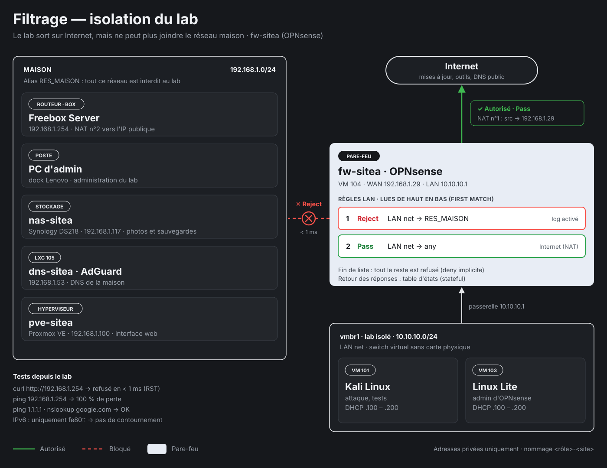
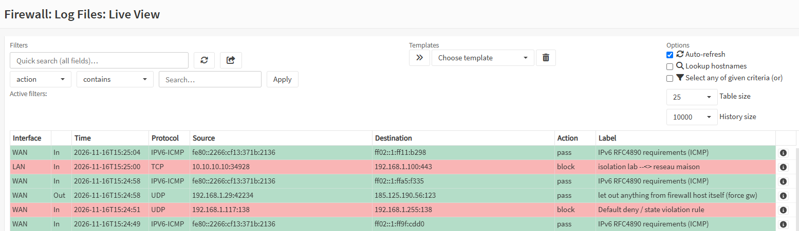

# 08 — Filtrage : isolation du lab derrière OPNsense

> Date : 14 novembre 2026 · Pare-feu : OPNsense (`fw-sitea`) · Hyperviseur : Proxmox VE (`pve-sitea`)

## Objectif

Empêcher les machines du lab (Kali, Linux Lite) d'atteindre le réseau domestique (box, NAS, poste d'administration, DNS, hyperviseur) tout en conservant leur accès à Internet.

**Pourquoi :** un lab cyber héberge des machines offensives ou volontairement vulnérables. Si l'une d'elles est compromise, l'isolation empêche le **mouvement latéral** vers les équipements de la maison.

## Architecture

- `vmbr1` n'est relié à aucune interface physique : la seule sortie du lab est OPNsense (passerelle par défaut `10.10.10.1`).
- Le lab sort sur Internet via le NAT sortant d'OPNsense, puis le NAT de la Freebox (double NAT).
- Le réseau maison ne peut pas initier de connexion vers le lab : aucune route sur la Freebox vers `10.10.10.0/24`, aucune règle Pass sur le WAN d'OPNsense (deny implicite) et option *Block private networks* active.

## Configuration

### 1. Alias

| Nom | Type | Contenu | Description |
| --- | --- | --- | --- |
| `RES_MAISON` | Network(s) | `192.168.1.0/24` | Réseau maison à protéger |

Choix d'un alias manuel plutôt que l'alias automatique `__wan_network` : l'alias décrit **ce qu'on protège** et ne change pas si l'adressage du WAN évolue.

### 2. Règle de filtrage (interface LAN)

| Champ | Valeur |
| --- | --- |
| Action | Reject |
| Interface | LAN |
| Direction | in |
| Version | IPv4 |
| Protocol | any |
| Source | LAN net |
| Destination | `RES_MAISON` |
| Destination port | any |
| Log | activé |
| Description | `isolation lab → reseau maison` |

**Choix techniques :**

- **Reject plutôt que Block** : en interne, le refus est immédiat (RST en TCP), ce qui accélère le diagnostic. Block reste réservé au WAN.
- **LAN in plutôt que WAN out** : on bloque au plus près de la source. Sur le WAN en sortie, le NAT a déjà remplacé l'adresse source, et une règle « source = LAN net » ne correspondrait plus.
- **Ordre** : la règle est placée **au-dessus** de « Default allow LAN to any » (évaluation *first match*).

### 3. Ordre des règles LAN à la fin de ce chapitre

État au 14 novembre. Les règles ont ensuite été passées en liste blanche : la version actuelle est dans la [fiche 10](10-liste-blanche.md).

| # | Action | Source | Destination | Rôle |
| --- | --- | --- | --- | --- |
| — | (règles automatiques, anti-lockout) | | | Accès à l'interface d'admin garanti |
| 1 | Reject | LAN net | `RES_MAISON` | Isolation |
| 2 | Pass | LAN net | any (IPv4) | Accès Internet |
| 3 | Pass | LAN net | any (IPv6) | Inutilisé (pas d'IPv6 routé sur le lab) |

## Validation

Tests réalisés depuis Linux Lite (lab) :

| Test | Attendu | Résultat |
| --- | --- | --- |
| `ping 192.168.1.254` (Freebox) | Bloqué | 100 % de perte |
| `curl -m 5 http://192.168.1.254` | Refus immédiat | `Couldn't connect` en < 1 ms (RST) |
| `ping 1.1.1.1` | Autorisé | OK |
| `nslookup google.com` | Autorisé | OK (résolution via OPNsense / Unbound) |
| `ip -6 addr` / `ip -6 route` | Pas d'IPv6 global | Uniquement `fe80::` et `::1`, pas de route par défaut |

Logs : *Firewall → Log Files → Live View*, filtre `label contains isolation` → entrées `LAN / in / block` avec la description de la règle.

*Preuve dans les logs : Kali (`10.10.10.10`) tente de joindre l'interface web de l'hyperviseur (`192.168.1.100:443`) ; la connexion est bloquée par la règle « isolation lab → réseau maison » (ligne rouge, interface LAN, sens in).*

## Pièges rencontrés et corrections

### L'alias rempli par l'autocomplétion
- **Constat** : en saisissant le contenu de `RES_MAISON`, la liste déroulante a sélectionné `__lan_network` (le réseau du lab lui-même), puis `__wan_network`.
- **Risque** : avec `__lan_network`, la règle serait devenue « lab → lab ». Elle n'aurait rien bloqué, et l'isolation aurait semblé en place sans l'être.
- **Correction** : saisie en mode *Text* (sans autocomplétion), puis vérification du contenu dans la liste des alias. Alias manuel préféré à `__wan_network`, qui changerait de valeur si l'adressage du WAN évoluait.

### L'adresse WAN du pare-feu
- **Constat** : tentative d'accès à l'interface d'OPNsense sur `192.168.1.129` : la page tournait dans le vide.
- **Cause** : l'adresse WAN réelle est `192.168.1.29`, vérifiée dans *Interfaces → Overview*.
- **Leçon** : vérifier une adresse à la source plutôt que de mémoire.

### Le ping « ignoré » malgré l'action Reject
- **Constat** : le ping vers la Freebox restait sans réponse, au lieu d'un refus immédiat.
- **Explication** : Reject renvoie un RST en TCP et un ICMP *unreachable* en UDP, mais jette l'ICMP en silence.
- **Validation** : test en TCP (`curl`), refusé en moins d'une milliseconde.

### Une Live View noyée par le bruit
- **Constat** : le trafic du pare-feu lui-même (DNS, NTP) et le multicast de la maison masquaient les lignes utiles.
- **Correction** : filtre sur le label de la règle (`label contains isolation`).

## Points d'attention

- **IPv6** : la règle ne couvre que l'IPv4. Si l'IPv6 est un jour activé sur le LAN, dupliquer la règle en IPv6.
- **Table d'états** : une connexion déjà établie peut survivre à une nouvelle règle de blocage. Relancer les tests ou vider les états (*Firewall → Diagnostics → States*).
- **Reject et ICMP** : Reject jette l'ICMP en silence. Le refus immédiat n'est visible qu'en TCP/UDP.
- **Administration** : à la date de ce chapitre, l'interface web d'OPNsense n'était joignable que depuis le lab (`10.10.10.1`). Elle est depuis ouverte au seul PC d'admin, en HTTPS, côté WAN ([fiche 09](09-acces-admin.md)).

## Prochaines étapes

- [x] Passer en liste blanche (moindre privilège) : fait, voir la [fiche 10](10-liste-blanche.md)
- [ ] Déployer un FortiGate sur le site B (NUC, `pve-siteb`)
- [ ] Tunnel IPsec OPNsense ↔ FortiGate
- [ ] VPN utilisateurs + MFA (FortiClient)
- [ ] Inspection SSL
- [ ] Export des logs du pare-feu vers le Synology (Log Center)
