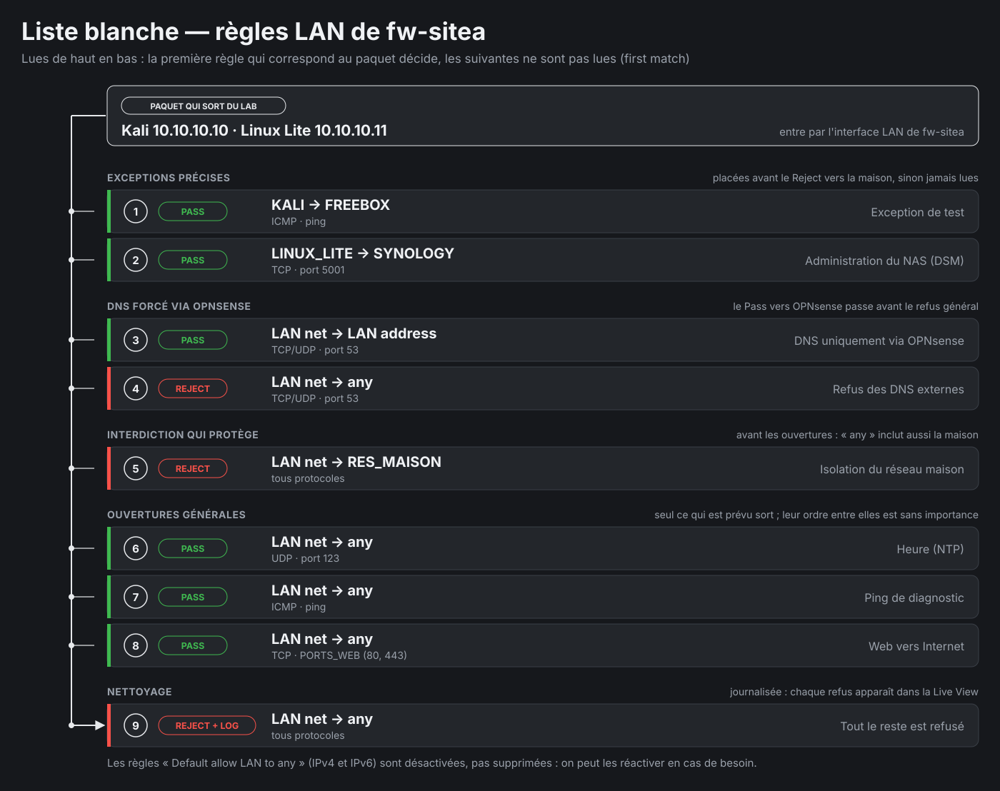
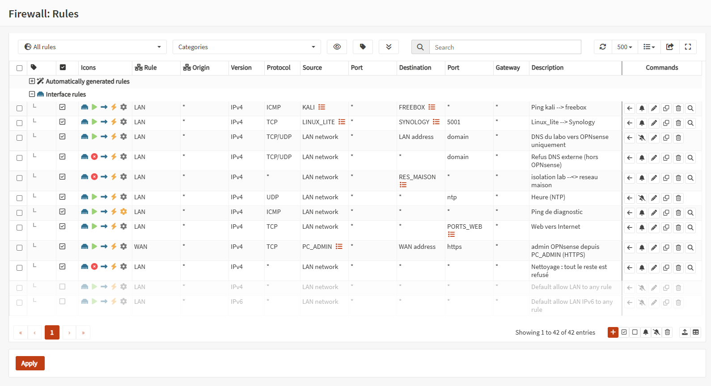
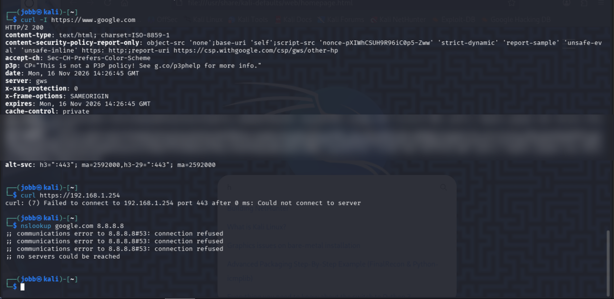

# 10 — Liste blanche sur le lab (moindre privilège)

[← 09 · Accès d'administration](09-acces-admin.md) · [Sommaire de la documentation](README.md) · [11 · Site B : FortiGate →](11-fortigate-site-b.md)

> Date : 16 novembre 2026 · Pare-feu : OPNsense (`fw-sitea`) · Interface : LAN

## Objectif

Passer la porte du lab de « tout est autorisé sauf la maison » (liste noire) à « seul ce qui est prévu peut sortir » (liste blanche). Chaque flux autorisé a une raison d'exister.

**Pourquoi :** avec une liste noire, une VM compromise peut sortir vers Internet sur n'importe quel port (exfiltration, communication avec un serveur de commande). Avec une liste blanche, elle ne peut utiliser que les services explicitement autorisés.

## Prérequis : des IP fixes pour les règles ciblées

Le DHCP du lab est assuré par **Dnsmasq** (Kea est installé mais inactif). La plage dynamique réelle était celle par défaut (`.41–.245`) ; elle a été alignée sur le plan d'adressage.

| Élément | Valeur |
| --- | --- |
| Plage DHCP | `10.10.10.100` – `10.10.10.200` |
| IP fixes | `10.10.10.2` – `10.10.10.99` |
| Kali | `10.10.10.10` (réservation Dnsmasq par adresse MAC) |
| Linux Lite | `10.10.10.11` (réservation Dnsmasq par adresse MAC) |

**Pourquoi des IP fixes :** les règles s'appuient sur des alias (`KALI`, `LINUX_LITE`) qui contiennent une adresse IP. Si une VM change d'adresse au renouvellement de son bail DHCP, l'alias pointe vers une adresse qui n'est plus la sienne : la règle ne s'applique plus à la bonne machine, voire s'applique à une autre. Chaque machine visée par une règle reçoit donc une réservation DHCP.

Les VM affichent toujours `dynamic` dans `ip a` : l'adresse est obtenue par DHCP, mais le serveur donne toujours la même. La réservation se vérifie côté serveur (bail de type *static*).

## Alias

| Nom | Type | Contenu |
| --- | --- | --- |
| `KALI` | Host(s) | `10.10.10.10` |
| `LINUX_LITE` | Host(s) | `10.10.10.11` |
| `FREEBOX` | Host(s) | `192.168.1.254` |
| `SYNOLOGY` | Host(s) | `192.168.1.117` |
| `RES_MAISON` | Network(s) | `192.168.1.0/24` |
| `PORTS_WEB` | Port(s) | `80`, `443` |
| `RESEAUX_PRIVES` | Network(s) | `10.0.0.0/8`, `172.16.0.0/12`, `192.168.0.0/16` (RFC 1918), ajouté en [fiche 14](14-regles-tunnel.md) |

## Règles LAN (lues de haut en bas)

| # | Action | Protocole | Source | Destination | Port | Rôle |
| --- | --- | --- | --- | --- | --- | --- |
| 1 | Pass | ICMP (echo request) | KALI | FREEBOX | — | Exception de test |
| 2 | Pass | TCP | LINUX_LITE | SYNOLOGY | 5001 | Administration du NAS (DSM) |
| 3 | Pass | TCP/UDP | LAN net | LAN address | 53 | DNS uniquement via OPNsense |
| 4 | Reject | TCP/UDP | LAN net | any | 53 | Refus des DNS externes |
| 5 | Reject | any | LAN net | RES_MAISON | — | Isolation du réseau maison |
| 6 | Pass | UDP | LAN net | any | 123 | Heure (NTP) |
| 7 | Pass | ICMP (echo request) | LAN net | any | — | Ping de diagnostic |
| 8 | Pass | TCP | LAN net | `! RESEAUX_PRIVES` | PORTS_WEB | Web vers Internet (tout sauf les réseaux privés) |
| 9 | Reject + log | any | LAN net | any | — | Nettoyage : tout le reste est refusé |

### Le trajet d'un paquet dans ces règles

Le premier test qui répond « oui » décide : les règles en dessous ne sont jamais lues (*first match*).

Les règles « Default allow LAN to any » (IPv4 et IPv6) sont **désactivées**, pas supprimées.

*La configuration réelle dans OPNsense (vue « All rules ») : les 9 règles LAN dans l'ordre, la règle WAN de la [fiche 09](09-acces-admin.md) et, grisées en bas, les deux règles par défaut désactivées.*

> **Mise à jour du 17 novembre 2026 ([fiche 14](14-regles-tunnel.md))** : avec le tunnel IPsec, *any* incluait aussi le réseau de l'agence 2. La règle 8 laissait donc tout le lab faire du web vers l'agence. Sa destination est maintenant `! RESEAUX_PRIVES` (case *Invert Destination*), c'est-à-dire vraiment Internet. Deux règles du tunnel (Kali → `poste-sitec`, SSH et ping) sont insérées entre les règles 5 et 6. La capture ci-dessus montre l'état d'avant.

**Logique d'ordre :** exceptions précises → interdictions qui protègent → ouvertures générales → nettoyage.

**Choix techniques :**

- **Règle 5 au-dessus des règles 6 à 8** : « any » inclut la maison (Freebox, NAS). Sans le Reject placé avant, les ouvertures (NTP, ping, web) rouvriraient ces flux vers le réseau domestique. Entre elles, les règles 6 à 8 peuvent être dans n'importe quel ordre : elles ne se chevauchent pas.
- **Règle de nettoyage explicite** : le deny implicite bloquerait déjà, mais sans log. Le nettoyage rend chaque refus visible dans la Live View.
- **Interface = LAN** sur toutes les règles : une règle avec interface « any » devient flottante et serait évaluée avant les règles d'interface.
- **Reject** en interne : refus immédiat, diagnostic plus rapide.

## Validation

| Depuis | Test | Résultat |
| --- | --- | --- |
| Kali | `nslookup google.com` | OK (via 10.10.10.1) |
| Kali | `nslookup google.com 8.8.8.8` | Refusé (connection refused) |
| Kali | `curl -I https://www.google.com` | HTTP/2 200 |
| Kali | `ping 8.8.8.8` | OK |
| Kali | `ping 192.168.1.254` | OK (exception) |
| Kali | `curl https://192.168.1.254` | Refusé (isolation) |
| Kali | `curl https://portquiz.net:8000` | Refusé (nettoyage, vérifié dans la Live View) |
| Kali | `timedatectl` | Horloge synchronisée |
| Linux Lite | Interface DSM (5001) | OK |
| Linux Lite | `ping 192.168.1.254` | Refusé |

*Trois tests depuis Kali : `curl` vers Google répond `HTTP/2 200` (règle 8), `curl` vers la Freebox échoue en 0 ms (refus immédiat de la règle 5), et `nslookup` vers 8.8.8.8 est refusé (règle 4 : DNS externe interdit).*

## Pièges rencontrés et corrections

### Réservation créée dans le mauvais service
- **Constat** : la page *Reservations* de Kea était vide, et la page des baux de Kea aussi, alors que les VM avaient bien une adresse.
- **Cause** : Kea est installé mais inactif ; c'est Dnsmasq qui distribue les adresses du lab (Kali visible dans les baux de Dnsmasq).
- **Leçon** : vérifier quel service tourne réellement avant de le configurer. Jamais deux serveurs DHCP actifs sur un même réseau.

### Plage DHCP différente de la documentation
- **Constat** : Linux Lite avait reçu `.82`, alors que la documentation annonçait `.100–.200`.
- **Cause** : la plage réelle était `.41–.245` (valeur par défaut) ; la correction notée dans la fiche 02 n'avait pas été appliquée.
- **Correction** : plage ramenée à `.100–.200` et vérifiée (Linux Lite passée en `.139`), puis réservations en `.10` et `.11`, hors de la plage dynamique.

### Erreurs d'écriture de règles, détectées et corrigées
- **Destination « WAN address » au lieu de la Freebox** : les alias automatiques désignent le pare-feu ou ses réseaux, jamais un autre appareil. Alias `FREEBOX` créé.
- **Exception placée sous le Reject vers la maison** : jamais lue (*first match*). Remontée au-dessus.
- **UDP au lieu de TCP pour DSM, port source renseigné** : HTTPS fonctionne en TCP, et le port source est tiré au hasard par le client : il reste sur *any*.
- **Règles créées avec l'interface « any »** : elles deviennent flottantes et sont évaluées avant les règles d'interface (une ouverture du web aurait contourné l'isolation de la maison). Repassées sur LAN.
- **Règles d'ouverture créées en bas de liste**, sous la règle de nettoyage : jamais lues. Déplacées au-dessus.
- **Règles DNS sans port et refus visant la Freebox** : corrigées en port 53 et destination *any*.

### Accès DSM instable pendant les tests
- **Constat** : l'accès fonctionnait puis était bloqué par le Reject vers la maison ; selon les essais (port de destination vide, 443, 5001), le résultat changeait d'une fois à l'autre.
- **Diagnostic** : lecture de la ligne bloquée dans la Live View et comparaison, champ par champ, avec la règle. DSM écoute en HTTPS sur le port 5001, pas sur 443.
- **Explication probable des résultats incohérents** : des connexions déjà ouvertes restent dans la table d'états et continuent de passer après une modification de règle, ce qui fausse les tests successifs.
- **Correction** : port de destination 5001, port source *any*. Leçon : couper les connexions en cours (ou vider les états) entre deux tests.

## Limites connues

- **DNS over HTTPS** (DoH) passe par le port 443 et contourne la règle DNS. Le bloquer demande des listes de serveurs DoH ou un NGFW qui identifie l'application.
- **Nouveaux besoins** (un outil de Kali sur un autre port) : à ajouter comme exception, après lecture des refus de la règle de nettoyage.

---

[← 09 · Accès d'administration](09-acces-admin.md) · [Sommaire de la documentation](README.md) · [11 · Site B : FortiGate →](11-fortigate-site-b.md)
