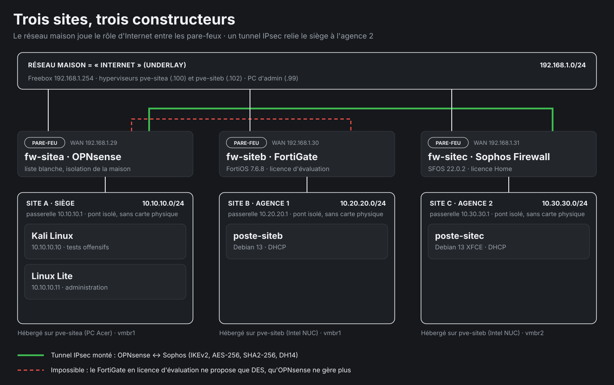
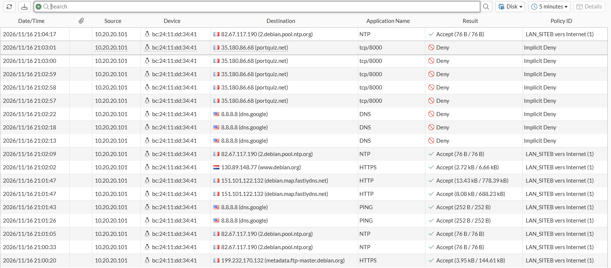

# 11 — Site B : un FortiGate en VM (FortiOS)

[← 10 · Liste blanche](10-liste-blanche.md) · [Sommaire de la documentation](README.md) · [12 · Site C : Sophos →](12-sophos-site-c.md)

> Date : 16 novembre 2026 · Pare-feu : FortiGate VM (`fw-siteb`), FortiOS 7.6.8, licence d'évaluation · Hyperviseur : Proxmox VE (`pve-siteb`, Intel NUC)

## Objectif

Créer une agence (site B) protégée par un pare-feu d'un autre constructeur que le siège, pour apprendre FortiOS (CLI, objets, règles, logs) et tenter de relier les deux sites par un tunnel IPsec.



## Architecture

| Élément | Valeur |
| --- | --- |
| VM | 201 `fw-siteb` · 1 vCPU et 2 Go (le plafond de la licence d'évaluation) · disque système + disque de logs de 8 Go |
| port1 = WAN | carte `net0` sur `vmbr0` (réseau maison) · `192.168.1.30`, réservé sur la Freebox |
| port2 = LAN | carte `net1` sur `vmbr1` (pont sans carte physique ni IP) · `10.20.20.1/24` |
| Poste de test | VM 202 `poste-siteb` · Debian 13 sans interface graphique · adresse DHCP |

**Pourquoi `vmbr1` n'a pas d'IP :** le pont est un switch virtuel. Si l'hyperviseur avait une adresse dans le lab, il deviendrait un second chemin entre le lab et la maison, qui contournerait le pare-feu.

## Installation

1. Image téléchargée sur le support Fortinet : **New deployment of FortiGate for KVM**, `FGT_VM64_KVM-v7.6.8…out.kvm.zip`, empreinte SHA-512 vérifiée (`Get-FileHash`).
   - `FGT` et pas `FFW` (FortiFirewall, un autre produit) ; `VM64` et pas `ARM64` (le NUC est en x86) ; *New deployment* (contient le disque `fortios.qcow2`) et pas *Upgrade* (système seul).
   - Branche 7.6 plutôt que 8.0 : la 7.6 en est à sa 8ᵉ version de correctifs, la 8.0 venait de sortir.
2. VM créée en ligne de commande sur Proxmox, puis disque importé :

```bash
qm create 201 --name fw-siteb --memory 2048 --cores 1 --cpu host --ostype l26 \
  --net0 virtio,bridge=vmbr0 --net1 virtio,bridge=vmbr1 --onboot 1
qm disk import 201 /root/fortios.qcow2 local-lvm
qm set 201 --virtio0 local-lvm:vm-201-disk-0 --virtio1 local-lvm:8 --boot order=virtio0
```

L'ordre des cartes décide du rôle : la 1ʳᵉ devient port1 (WAN), la 2ᵉ port2 (LAN). Au premier démarrage, FortiOS formate le disque de logs (`LOGUSED`) et redémarre une fois.

## Licence d'évaluation : ce qu'elle permet

| Limite | Conséquence dans le lab |
| --- | --- |
| Chiffrement faible uniquement (DES) | Tunnel IPsec impossible avec OPNsense ([fiche 13](13-tunnel-ipsec.md)) ; VPN SSL et inspection SSL impossibles |
| 1 vCPU, 2 Go de RAM | Suffisant pour un lab |
| 3 interfaces, 3 règles, 3 routes | Chaque règle doit être choisie avec soin |
| Pas de mises à jour FortiGuard | IPS et antivirus fonctionnent avec les signatures livrées dans l'image (2015 et 2018) : ils ne reconnaîtraient aucune attaque récente |
| Une seule VM d'évaluation par compte | VM sauvegardée dans Proxmox juste après l'activation, sauvegarde protégée |

## Configuration de base (CLI)

```
config system global
    set hostname fw-siteb
end
config system interface
    edit port1
        set alias WAN
        set role wan
        set allowaccess ping https
    next
    edit port2
        set alias LAN
        set role lan
        set mode static
        set ip 10.20.20.1 255.255.255.0
        set allowaccess ping
    next
end
config system admin
    edit admin
        set trusthost1 192.168.1.99 255.255.255.255
    next
end
```

**Deux types de trafic sur un FortiGate :**
- le trafic qui **traverse** le pare-feu est contrôlé par les **règles** (*firewall policies*) ;
- le trafic **destiné au pare-feu** (interface web, SSH, ping) est contrôlé par **`allowaccess`**, interface par interface.

Par défaut, le WAN autorisait `ping https ssh http` : l'interface d'administration était joignable depuis toute la maison, et même en clair. L'accès est réduit à `ping https`, et le compte `admin` est limité au PC d'admin par un *trusted host*. La console Proxmox reste un accès de secours qui ne dépend pas du réseau.

Fuseau horaire réglé sur Paris (les logs des trois pare-feux doivent être comparables) et mises à jour automatiques désactivées (en entreprise, une mise à jour se planifie).

## Réseau de l'agence

| Élément | Réglage | Pourquoi |
| --- | --- | --- |
| DNS | `config system dns-server` → `edit port2` (mode récursif, par défaut) | Les postes interrogent le FortiGate. Ce trafic est destiné au pare-feu lui-même : il ne consomme aucune des 3 règles |
| DHCP | `10.20.20.100` – `10.20.20.200`, passerelle et DNS = `10.20.20.1` | Même découpage que le site A |
| Objet | `LAN_SITEB` = `10.20.20.0/24` | Équivalent d'un alias OPNsense |
| Règle 1/3 | `LAN_SITEB vers Internet` : port2 → port1, `LAN_SITEB` → `all`, services HTTP, HTTPS, NTP, PING ; NAT sur l'adresse de port1 ; log de toutes les sessions | Liste blanche, comme au site A |
| Refus | `config log setting` → `set fwpolicy-implicit-log enable` | Le refus implicite est journalisé, sans dépenser de règle de nettoyage |

**Différences avec OPNsense :** une règle FortiGate a une interface d'entrée **et** une interface de sortie, le NAT se règle dans la règle elle-même, et il n'y a pas d'*Apply* : `end` ou OK appliquent immédiatement.

## Validation

| Depuis `poste-siteb` | Résultat |
| --- | --- |
| `ip a` / `ip route` / `resolv.conf` | `10.20.20.101`, passerelle et DNS `10.20.20.1` |
| `ping -c 3 8.8.8.8` | OK, TTL 115 (un de moins que depuis le FortiGate : un routeur de plus sur le chemin) |
| `curl -I https://www.debian.org` | `HTTP/2 200` |
| `nslookup google.com 8.8.8.8` | Refusé (`timed out`) |
| `curl -m 5 http://portquiz.net:8000` | Refusé (`timed out`) |



*Les connexions autorisées portent la règle `LAN_SITEB vers Internet (1)` ; les refus portent `Implicit Deny`. Le NTP vers `2.debian.pool.ntp.org` n'a pas été lancé à la main : c'est la Debian qui met son horloge à l'heure. Le test vers le port 8000 produit cinq lignes, parce que le refus implicite jette les paquets en silence et que le client renvoie sa demande de connexion chaque seconde.*

## Pièges rencontrés et corrections

- **Erreurs de saisie dans la console Proxmox** : un `~` ajouté au collage (`--onboot 1~`), puis un clavier passé en QWERTY (`admin` tapé « qd,in »). Leçon : lire la dernière ligne d'une erreur, et vérifier la disposition du clavier avant de taper un mot de passe.
- **Politique de mot de passe** : FortiOS 7.6 impose 12 caractères avec majuscule, minuscule, chiffre et caractère spécial.
- **`scp` lancé depuis `C:\WINDOWS\system32`** : le chemin relatif `.\fortios.qcow2` pointait vers le mauvais dossier. Corrigé depuis le dossier Téléchargements, dans un PowerShell sans droits administrateur.
- **Pont `vmbr1` en « Pending changes »** : la configuration réseau de Proxmox doit être appliquée (*Apply Configuration*), sinon la VM ne peut pas s'y brancher.
- **`show` n'affiche pas `mode recursive`** : `show` n'affiche que ce qui diffère des valeurs par défaut (`show full-configuration` affiche tout).
- **Adresse DHCP passée de `.100` à `.101`** : l'installeur Debian et le système installé ne se présentent pas au DHCP avec le même identifiant client. Une machine visée par une règle doit avoir une réservation.

## Limite connue, à corriger

La destination `all` de la règle 1 inclut le réseau maison : le poste de l'agence peut joindre la Freebox ou le NAS en HTTP, HTTPS et ping. Une règle d'isolation vers `192.168.1.0/24`, placée avant, sera ajoutée (la règle 2 sur les 3 autorisées).

---

[← 10 · Liste blanche](10-liste-blanche.md) · [Sommaire de la documentation](README.md) · [12 · Site C : Sophos →](12-sophos-site-c.md)
