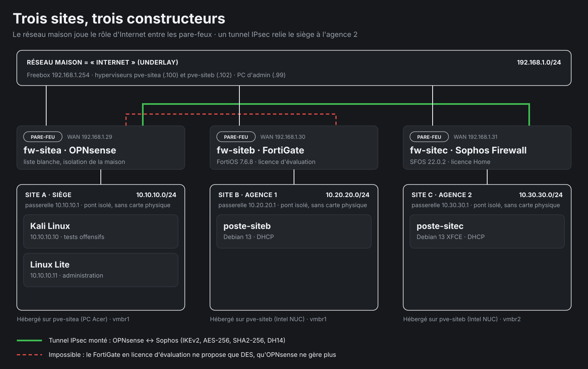
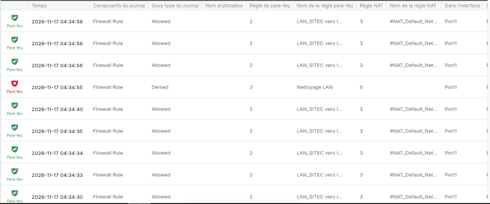

# 12 — Site C : Sophos Firewall Home

[← 11 · Site B : FortiGate](11-fortigate-site-b.md) · [Sommaire de la documentation](README.md) · [13 · Tunnel IPsec →](13-tunnel-ipsec.md)

> Date : 16 et 17 novembre 2026 · Pare-feu : Sophos Firewall (`fw-sitec`), SFOS 22.0.2 MR-2, licence Home · Hyperviseur : Proxmox VE (`pve-siteb`, Intel NUC)

## Pourquoi un troisième site

Le FortiGate en licence d'évaluation ne peut pas monter de tunnel avec OPNsense ([fiche 13](13-tunnel-ipsec.md)). Plutôt que de le supprimer, j'ai ajouté une deuxième agence protégée par **Sophos Firewall Home** : gratuit pour un usage personnel, sans limite de durée, avec le chiffrement fort et les mêmes fonctions que les appliances. Résultat : trois sites, trois constructeurs.

## Architecture

| Élément | Valeur |
| --- | --- |
| VM | 301 `fw-sitec` · 2 vCPU, 4 Go, disque de 80 Go (*thin provisioning*, *discard* activé) · BIOS SeaBIOS (Sophos Home ne démarre pas en UEFI) |
| Port1 = LAN | carte `net0` sur `vmbr2` (pont sans carte physique ni IP) · `10.30.30.1/24` |
| Port2 = WAN | carte `net1` sur `vmbr0` · `192.168.1.31` (DHCP, réservé sur la Freebox) |
| Poste de test | VM 302 `poste-sitec` · Debian 13 XFCE · `10.30.30.100` (DHCP) |

**L'ordre des cartes est l'inverse du FortiGate :** chez Sophos, Port1 est le LAN. Brancher la 1ʳᵉ carte sur le réseau maison aurait placé le LAN de Sophos, avec son serveur DHCP actif dès la sortie d'usine (`172.16.16.0/24`), au milieu des appareils de la famille : un serveur DHCP pirate (*rogue DHCP*).

## Installation et assistant

1. ISO `SW-22.0.2_MR-2-546.iso` (version *Software*), téléversée dans Proxmox.
2. Sophos s'administre depuis son LAN (`https://172.16.16.16:4444` en usine). Le LAN étant isolé, une VM démarrée sur l'image **live** de Debian XFCE (aucune installation, aucun accès Internet nécessaire) a servi de poste d'administration. Le même ISO a ensuite installé Debian définitivement.
3. Assistant :

| Écran | Choix | Pourquoi |
| --- | --- | --- |
| Mot de passe admin | Long, vérifié avec l'œil d'affichage | Clavier de la session live passé en AZERTY avant la saisie |
| Clé maîtresse du stockage sécurisé | Différente du mot de passe, conservée dans un gestionnaire | Elle chiffre les secrets de la configuration (clés VPN…) ; sans elle, une sauvegarde est irrestaurable |
| Mise à jour pendant l'installation | Non | Version figée pour la documentation ; en entreprise, une mise à jour se planifie |
| Nom et fuseau | `fw-sitec.lab.home.arpa`, `Europe/Paris` | Même famille de noms et même heure que les autres pare-feux |
| Licence | Numéro de série Home (non publié ici) | L'option « essai » ne donne que 30 jours |
| Programme d'amélioration | Non | Pas d'envoi de données d'usage |
| LAN | `10.30.30.1/24`, DHCP `.100–.200` | Même découpage que les sites A et B |
| WAN | DHCP sur Port2 | Puis réservation `.31` sur la Freebox |
| Protections (IPS, filtrage web, antivirus, bac à sable) | Désactivées pour l'instant | Une seule variable à la fois pendant la mise en place du tunnel ; à activer ensuite, une par une |
| Sauvegardes par e-mail | Non | Envoi direct en SMTP bloqué par le fournisseur d'accès ; sauvegardes faites dans Proxmox |

## Concepts Sophos

- **Zones** : les règles s'écrivent de zone à zone (LAN → WAN), pas d'interface à interface. Une interface ajoutée à une zone hérite de ses règles.
- **Local service ACL** (*Administration → Accès à l'appareil*) : quels services du pare-feu (HTTPS, SSH, ping, IPsec…) répondent depuis quelle zone. Côté WAN, tout est fermé par défaut ; seule la case **IPsec** a été ouverte, pour le tunnel.
- **NAT lié** (*LinkedNAT*) : les règles NAT forment une liste séparée, rattachée à la règle de pare-feu. Le journal affiche sur une même ligne la règle qui autorise et la règle qui traduit.

| | Une règle s'écrit entre… | Services du pare-feu lui-même |
| --- | --- | --- |
| OPNsense | une interface (la règle y est posée) | règles vers *WAN address* |
| FortiGate | une interface d'entrée et une de sortie | `allowaccess`, par interface |
| Sophos | une zone source et une zone destination | *Local service ACL*, par zone |

## Règles

| # | Règle | Source → destination | Services | Action |
| --- | --- | --- | --- | --- |
| 1 | Règle MTA ajoutée automatiquement | toute zone → toute zone | SMTP, SMTPS | **Désactivée** : aucun serveur de mail, et ouverte depuis le WAN |
| 2 | `LAN_SITEC vers Internet` | LAN (`LAN_SITEC`) → WAN | HTTP, HTTPS, NTP, ping | Accept, journalisée, NAT lié |
| 3 | `Nettoyage LAN` | LAN → toutes zones | tous | **Reject**, journalisée |
| 0 | *Drop all* | tout → tout | tous | Drop, non journalisé |

**Reject seulement pour le LAN :** en interne, un refus immédiat aide le diagnostic. Côté WAN, *Drop all* reste silencieux et ne confirme pas l'existence d'une machine.

## Validation

| Depuis `poste-sitec` | Résultat |
| --- | --- |
| `ip a` / `ip route` / `resolv.conf` | `10.30.30.100`, passerelle et DNS `10.30.30.1` |
| `sudo apt update` | OK (HTTP et HTTPS) |
| `ping -c 3 8.8.8.8` | OK, TTL 115 |
| `curl -I https://www.debian.org` | `HTTP/2 200` |
| `nslookup google.com 8.8.8.8` | Refusé |
| `curl -m 5 http://portquiz.net:8000` | Refusé : 5 s d'attente avec *Drop all*, refus immédiat avec la règle de nettoyage en Reject |

*Le même test vers le port 8000 produit cinq lignes de refus sur le FortiGate (refus silencieux : le client renvoie sa demande chaque seconde) et une seule ligne sur Sophos (Reject : le client abandonne tout de suite).*

## Pièges rencontrés et corrections

- **Bouton *Continue* de l'assistant sans effet** : la console du navigateur (F12) affichait `Language is not defined` et une erreur XML. Un rechargement (F5) au milieu de l'assistant avait cassé sa session. Corrigé en reprenant depuis la racine, dans une fenêtre privée. Leçon : quand un bouton web ne réagit pas, la console F12 dit presque toujours pourquoi.
- **Clavier QWERTY dans la session live** : `setxkbmap fr` avant toute saisie de mot de passe.
- **Empreinte refusée par Proxmox** : le champ *Checksum* contenait le nom du fichier `SHA512SUMS` au lieu de l'empreinte ; puis l'image `debian-mac` avait été choisie à la place de l'image standard. Le contrôle d'empreinte a bloqué les deux erreurs.
- **Téléchargement interrompu** (`Error decoding the received TLS packet`) : reprise automatique (`206 Partial Content`), puis empreinte vérifiée sur le fichier complet.
- **Interface web injoignable juste après un redémarrage** (`Unable to connect` alors que le ping répond) : le service web du port 4444 démarre parmi les derniers.
- **Refus invisibles** : *Drop all* ne journalise pas. Ajout de la règle `Nettoyage LAN`.
- **Lignes *Invalid Traffic*** après la sauvegarde de la VM : le redémarrage avait vidé la table d'états, et les paquets des connexions déjà ouvertes n'appartenaient plus à aucun état connu.

## Limite connue, à corriger

Comme au site B, la règle 2 vise toute la zone WAN, qui inclut le réseau maison. Une règle d'isolation vers `192.168.1.0/24` sera ajoutée avant elle.

---

[← 11 · Site B : FortiGate](11-fortigate-site-b.md) · [Sommaire de la documentation](README.md) · [13 · Tunnel IPsec →](13-tunnel-ipsec.md)
