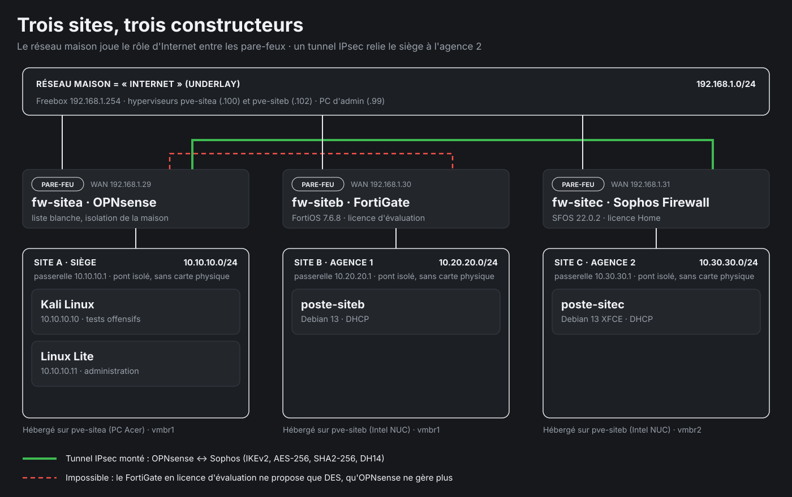
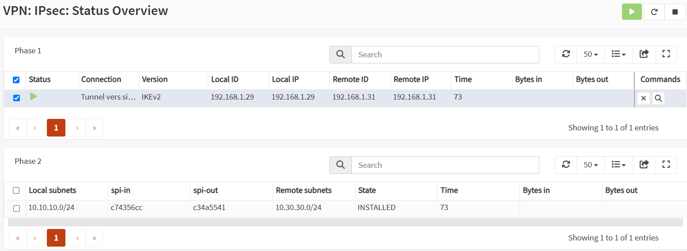
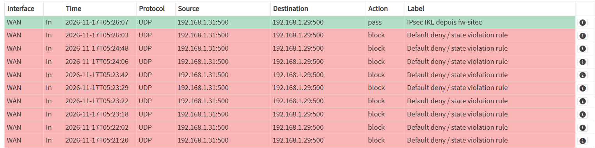

# 13 — Tunnel IPsec entre le siège (OPNsense) et l'agence 2 (Sophos)

> Date : 17 novembre 2026 · Site A : OPNsense (`fw-sitea`) · Site C : Sophos Firewall (`fw-sitec`)

## Objectif

Relier deux sites équipés de pare-feux de constructeurs différents par un tunnel IPsec, comme un siège et une agence reliés à travers Internet. Dans le lab, le réseau maison joue le rôle d'Internet (*underlay*) ; le tunnel est l'*overlay*.

| | Site A, le siège | Site C, l'agence 2 |
| --- | --- | --- |
| Pare-feu | OPNsense `fw-sitea` | Sophos `fw-sitec` |
| Adresse du correspondant (WAN) | `192.168.1.29` | `192.168.1.31` |
| Réseau protégé | `10.10.10.0/24` | `10.30.30.0/24` |

## Première tentative : le FortiGate (site B), impossible

Avant de configurer quoi que ce soit, les offres de chaque côté ont été comparées :

| | Phase 1 (IKE) | Phase 2 (ESP) |
| --- | --- | --- |
| FortiGate en licence d'évaluation (`set proposal ?`) | `des-md5` … `des-sha512` uniquement | `des-*` ou `null-*` (intégrité sans chiffrement) |
| OPNsense | AES, ChaCha20, options post-quantiques… **aucun DES** | — |

Aucune offre commune en phase 1 : la négociation ne peut pas aboutir. OPNsense a retiré DES (cassable), et le FortiGate gratuit est limité à DES. Cette vérification a pris vingt minutes et a évité des heures de lecture de journaux sur une négociation vouée à l'échec. Le FortiGate reste dans le lab pour FortiOS ; le tunnel est monté avec Sophos ([fiche 12](12-sophos-site-c.md)).

## Paramètres retenus, identiques des deux côtés

| Paramètre | Valeur | Pourquoi |
| --- | --- | --- |
| Version | IKEv2 | Plus simple et plus robuste qu'IKEv1 ; pas de mode agressif |
| Phase 1 | AES-256, SHA2-256, groupe DH 14 (MODP 2048), durée de vie 10 800 s | Une seule offre de chaque côté : en cas d'échec, une seule combinaison à vérifier |
| Phase 2 | AES-256, SHA2-256, PFS groupe 14, durée de vie 3 600 s | PFS : une clé neuve à chaque renouvellement |
| Authentification | Clé prépartagée (longue phrase de passe), identifiants = adresses WAN | Les identifiants permettent une clé propre à chaque tunnel en IKEv2 |
| Dead Peer Detection | Toutes les 30 s, tunnel rétabli automatiquement | « Réinitialiser » chez Sophos, *DPD action : Start* chez OPNsense |
| Type | Basé sur les stratégies (*policy-based*) des deux côtés | Les réseaux du tunnel sont déclarés dans sa configuration ; le même modèle des deux côtés |

**Groupe 14 plutôt que 19 ou 31 :** c'est le dénominateur commun le plus répandu. En production, une courbe elliptique (groupes 19 ou 31) est plus rapide à robustesse égale.

## Configuration

### Sophos (site C)

1. **Profil IPsec** `Tunnel_SiteA_IKEv2` : IKEv2, profil strict, une seule combinaison par phase, troncature SHA2 à 96 bits **décochée** (le standard est 128 bits ; une différence ici laisse la phase 1 monter mais bloque tout le trafic).
2. **Connexion** `Tunnel_SiteA` : basée sur les stratégies, initie la connexion, Port2 `192.168.1.31` → `192.168.1.29`, identifiants en adresse IP, sous-réseau local `LAN_SITEC`, distant `LAN_SITEA` ; règle de pare-feu automatique **non créée** ; NAT non coché (les plages sont distinctes).
3. **Accès à l'appareil** : case IPsec cochée sur la ligne WAN, et rien d'autre.

### OPNsense (site A)

1. **Pre-Shared Keys** : local `192.168.1.29`, distant `192.168.1.31`, type PSK.
2. **Connection** : proposition `aes256-sha256-modp2048` seule, IKEv2, `192.168.1.29` → `192.168.1.31`, *rekey time* 10 800 s, DPD 30 s ; authentification locale et distante par clé prépartagée.
3. **Child** : mode tunnel, `10.10.10.0/24` ↔ `10.30.30.0/24`, ESP `aes256-sha256-modp2048`, *rekey time* 3 600 s, *start action* et *DPD action* : Start.
4. **Règles WAN** (source : alias `FW_SITEC` = `192.168.1.31` ; destination : *WAN address*) : UDP 500 (IKE), UDP 4500 (NAT-T), protocole ESP (sans port).

Les réseaux sont déclarés **en miroir** : le réseau local de l'un est le réseau distant de l'autre.

## Validation

- Sophos : connexion active et établie (voyants verts).
- OPNsense, *Status Overview* : phase 1 établie ; phase 2 `INSTALLED` (`10.10.10.0/24` ↔ `10.30.30.0/24`), avec un SPI par sens.

## Pièges rencontrés et corrections

- **Profil et connexion confondus** chez Sophos : le profil dit *comment* chiffrer, la connexion *avec qui* et *quels réseaux*.
- **Type « hôte à hôte »** : seuls les deux pare-feux auraient pu utiliser le tunnel, pas leurs réseaux. Remplacé par « basé sur les stratégies ».
- **Sous-réseaux local et distant inversés** chez Sophos : toujours raisonner du point de vue du pare-feu qu'on configure.
- **Clé prépartagée jugée faible** par Sophos : remplacée par une longue phrase de passe.
- **Règle créée avec l'interface `any`** dans le nouvel éditeur d'OPNsense : elle serait devenue flottante. Repassée sur WAN.
- **Port 4500 hérité du clonage sur la règle ESP** : ESP n'a pas de port.
- **« Service ipsec failed to stop » au premier *Apply*** : sans conséquence, le service n'avait jamais tourné ; la case *Enable IPsec* ne s'était pas enregistrée.
- **Demandes de Sophos bloquées par le *Default deny*** : l'alias `FW_SITEC` avait été enregistré mais pas appliqué. Il était donc vide dans le pare-feu (*Firewall → Diagnostics → Aliases*), et les trois règles ne correspondaient à rien. Diagnostic par couches : les paquets arrivent-ils (Live View) ? quelle règle les bloque (détail de la ligne) ? l'état réel correspond-il à la configuration (Diagnostics) ? Leçon : chaque section d'OPNsense a son propre *Apply*.

## Suite

Le tunnel est monté, mais aucun trafic n'y est encore autorisé : l'interface IPsec d'OPNsense et la zone VPN de Sophos n'ont pas de règle. Prochaine étape : des règles en moindre privilège (par exemple, Kali joint `poste-sitec` en SSH et en ping, et rien d'autre), puis le test de bout en bout avec les journaux des deux pare-feux.
