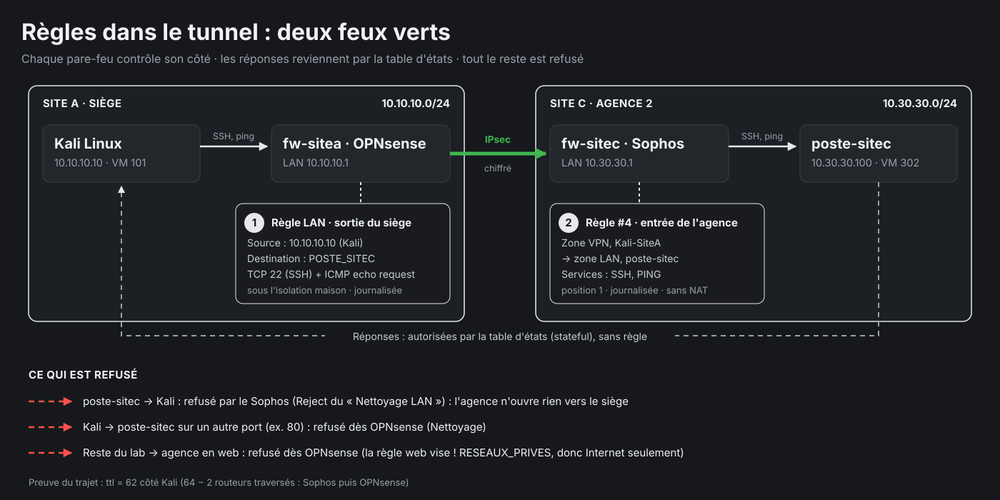
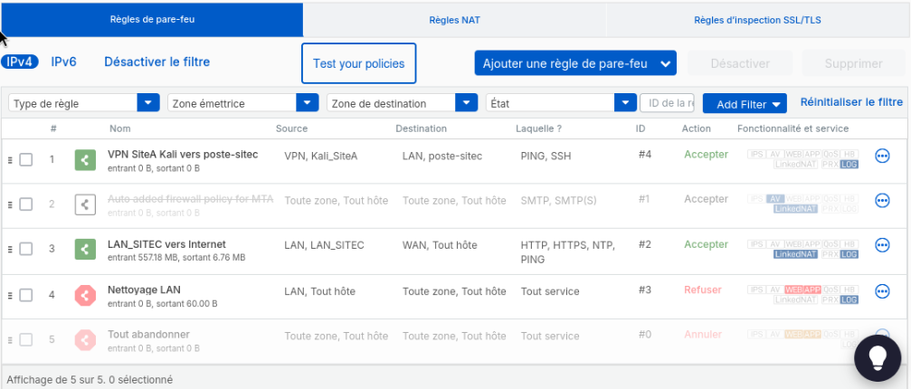
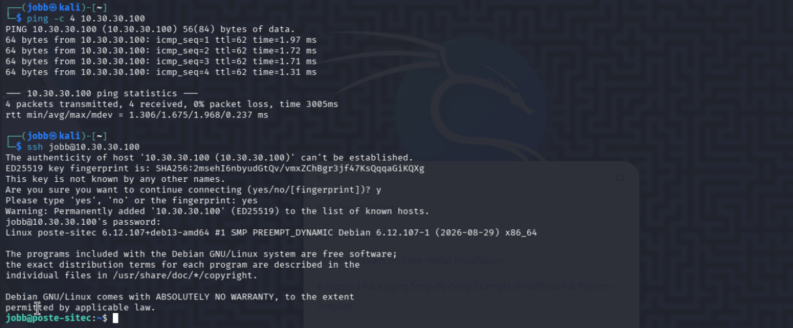
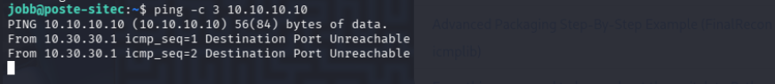
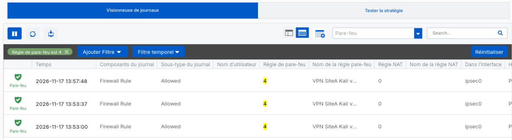
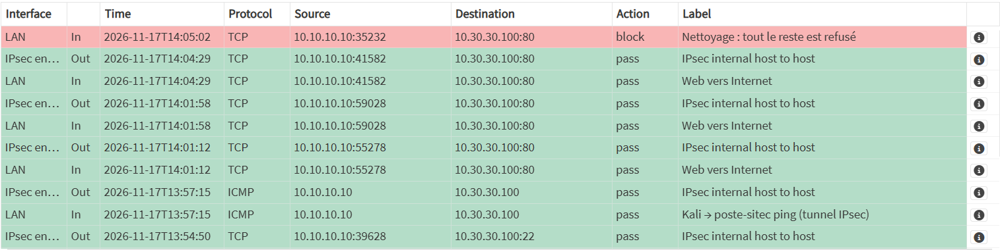
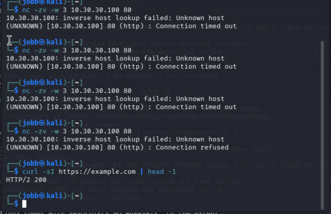

# 14 — Règles dans le tunnel : du tuyau chiffré au trafic autorisé

[← 13 · Tunnel IPsec](13-tunnel-ipsec.md) · [Sommaire de la documentation](README.md) · [Annexe · Inventaire IP →](inventaire-ip.md)

> Date : 17 novembre 2026 · Site A : OPNsense (`fw-sitea`) · Site C : Sophos Firewall (`fw-sitec`)

## Objectif

Le tunnel de la [fiche 13](13-tunnel-ipsec.md) est monté, mais il ne transporte rien. Un tunnel décide **comment** le trafic voyage (chiffré, entre quels réseaux) ; les règles de pare-feu décident **quel** trafic a le droit d'y entrer. Sans règle, le refus par défaut s'applique.

Objectif, en moindre privilège : Kali (siège) administre `poste-sitec` (agence 2) en SSH et le joint en ping. Rien d'autre, et rien dans l'autre sens.

## Pourquoi deux règles, et aucune pour les réponses

- **Chaque pare-feu ne contrôle que son côté.** OPNsense décide si le paquet peut **sortir** du siège ; Sophos décide s'il peut **entrer** dans l'agence. Chez un client, le siège et l'agence ont chacun leur politique : il faut les deux feux verts.
- **Les deux pare-feux sont *stateful*** : chaque connexion autorisée est mémorisée dans la table d'états. La réponse de `poste-sitec` est reconnue comme la suite d'une connexion acceptée et passe sans règle. Une connexion **ouverte** par `poste-sitec` vers le siège, elle, est refusée.

## Préparation de poste-sitec

- Adresse `10.30.30.100`, attribuée par le DHCP du Sophos (réservation à faire, voir *Suite*).
- Serveur SSH installé (`openssh-server`) : Debian avec bureau n'en installe pas par défaut. Sans lui, un échec du test SSH aurait orienté le diagnostic vers le tunnel alors que la cause était sur la machine.

## Configuration

### OPNsense (site A), interface LAN

Alias `POSTE_SITEC` (Host) = `10.30.30.100` : si l'adresse change, une seule modification.

| Action | Protocole | Source | Destination | Port | Log | Description |
| --- | --- | --- | --- | --- | --- | --- |
| Pass | TCP | `10.10.10.10` | `POSTE_SITEC` | 22 | oui | Kali → poste-sitec SSH (tunnel IPsec) |
| Pass | ICMP (echo request) | `10.10.10.10` | `POSTE_SITEC` | — | oui | Kali → poste-sitec ping (tunnel IPsec) |

**Placement** : **sous** l'isolation du réseau maison (un refus qui protège passe toujours avant les autorisations) et **au-dessus** de « Ping de diagnostic ». Placée dessous, la règle de ping n'aurait jamais servi : le ping aurait correspondu à la règle générale, et les journaux auraient affiché la mauvaise règle.

**Echo request seulement** : l'aller du ping. Le retour (*echo reply*) passe par la table d'états ; ouvrir tout l'ICMP autoriserait des types de messages inutiles ici.

### Sophos (site C)

Objets *Hôte IP* : `Kali-SiteA` = `10.10.10.10`, `poste-sitec` = `10.30.30.100`.

| Champ | Valeur |
| --- | --- |
| Règle | #4 « VPN SiteA Kali vers poste-sitec », **en position 1**, au-dessus du nettoyage |
| Action | Accepter, trafic journalisé |
| Source | zone **VPN** (tout ce qui sort d'un tunnel IPsec), `Kali-SiteA` |
| Destination | zone **LAN**, `poste-sitec` |
| Services | SSH, PING |
| NAT | **aucun** (pas de NAT lié) |

**Pourquoi pas de NAT** : dans un tunnel site à site, les deux réseaux se parlent avec leurs vraies adresses (d'où des plages distinctes, `10.10.10.0/24` et `10.30.30.0/24`). Avec un NAT, `poste-sitec` verrait le pare-feu comme source, et les journaux ne montreraient plus qui se connecte.

## Validation

| Test, depuis | Attendu | Résultat |
| --- | --- | --- |
| Ping Kali → poste-sitec | passe | ✅ 4/4, `ttl=62` |
| SSH Kali → poste-sitec | passe | ✅ empreinte ED25519 identique à celle générée à l'installation |
| Port 80 Kali → poste-sitec | bloqué | ✅ refusé (voir la faille ci-dessous) |
| Ping poste-sitec → Kali | bloqué | ✅ *Destination Port Unreachable* renvoyé par `10.30.30.1` (Sophos) |
| Web Kali → Internet | passe | ✅ `HTTP/2 200` |

- **`ttl=62`** : Linux envoie ses paquets avec un TTL de 64, et chaque routeur le diminue de 1. 64 − 62 = 2 routeurs traversés : Sophos puis OPNsense. Le paquet a bien fait le trajet d'un site à l'autre.
- **L'empreinte SSH** affichée par Kali (`SHA256:2msehI6n…`) est celle créée à l'installation d'`openssh-server` sur `poste-sitec` : Kali parle à la bonne machine.

**Journal du Sophos**, filtré sur la règle 4 : connexions autorisées, arrivées par `ipsec0` (la sortie du tunnel), règle NAT `0` (aucune traduction : `poste-sitec` voit bien `10.10.10.10`).

**Dans OPNsense**, chaque connexion produit deux lignes : `LAN · In` (la règle qui autorise la sortie) puis `IPsec enc0 · Out` (l'entrée dans le tunnel, autorisée par la règle automatique « IPsec internal host to host »).

## La faille trouvée dans les journaux

Le test du port 80 était bloqué… mais **par le Sophos**. Dans la Live View d'OPNsense, la connexion était **autorisée** par « Web vers Internet » ([fiche 10](10-liste-blanche.md)) : sa destination *any* inclut aussi les réseaux des agences, joignables par le tunnel. Tout le lab du siège pouvait donc faire du web vers l'agence 2.

C'est le même piège que sur les sites B et C : **« any » couvre plus que ce qu'on croit**. Ici, la défense en profondeur a protégé (le second pare-feu a bloqué), mais chaque pare-feu doit être correct à lui seul.

**Correction** : alias `RESEAUX_PRIVES` (Network) = `10.0.0.0/8`, `172.16.0.0/12`, `192.168.0.0/16` (les plages privées de la RFC 1918). Règle « Web vers Internet » : destination `RESEAUX_PRIVES` avec **Invert Destination**, affichée `! RESEAUX_PRIVES` = « tout sauf les réseaux privés », c'est-à-dire vraiment Internet. Elle couvre aussi les futurs sites sans modification.

**Vérification dans les deux sens** : le port 80 vers l'agence est refusé dès OPNsense par le nettoyage (ligne rouge), et le web vers Internet fonctionne toujours.

**Lire le message d'erreur pour savoir qui bloque et comment :**

| Message côté client | Signification | Ici |
| --- | --- | --- |
| *Connection timed out* | paquet jeté sans réponse (**Drop**) | « Tout abandonner » du Sophos, avant la correction |
| *Connection refused* | refus immédiat (**Reject**) | nettoyage d'OPNsense, après la correction |
| *Destination Port Unreachable* depuis `10.30.30.1` | refus immédiat du Sophos (**Reject**) | « Nettoyage LAN » du Sophos, ping de poste-sitec vers Kali |

## Pièges rencontrés et corrections

- **Port SSH resté sur la règle ICMP clonée** : OPNsense refuse d'enregistrer, un port n'existe qu'en TCP ou UDP (comme ESP, ICMP n'a pas de port).
- **Règle de ping placée sous « Ping de diagnostic »** : elle n'aurait jamais été atteinte. Remontée.
- **Règle Sophos créée en position « Bas » et sans journalisation** : sous le nettoyage, elle n'aurait jamais servi, et sans journal pas de preuve. Passée en « Haut », journalisation cochée.
- **Test « poste-sitec → Kali » lancé en réalité depuis Kali** (`ttl=64`, 0,03 ms : le paquet n'était pas sorti de la machine). Leçon : toujours lire l'invite avant de conclure.
- **Case *Invert Destination* oubliée** : la règle web autorisait **seulement** les réseaux privés, l'inverse du but. Repéré grâce à l'absence du `!` dans la liste des règles.
- **Journal du Sophos noyé** sous le trafic Internet de `poste-sitec` : filtre « Règle de pare-feu = 4 ».

## Suite

- Réserver `10.30.30.100` dans le DHCP du Sophos : les règles visent cette adresse.
- Sites B et C : même piège « any », leurs règles de sortie visent tout le WAN, qui inclut le réseau maison. Ajouter un refus vers `192.168.1.0/24` avant les autorisations.
- « Ping de diagnostic » autorise aussi le ping vers les agences : acceptable dans un lab, à limiter chez un client.

---

[← 13 · Tunnel IPsec](13-tunnel-ipsec.md) · [Sommaire de la documentation](README.md) · [Annexe · Inventaire IP →](inventaire-ip.md)
