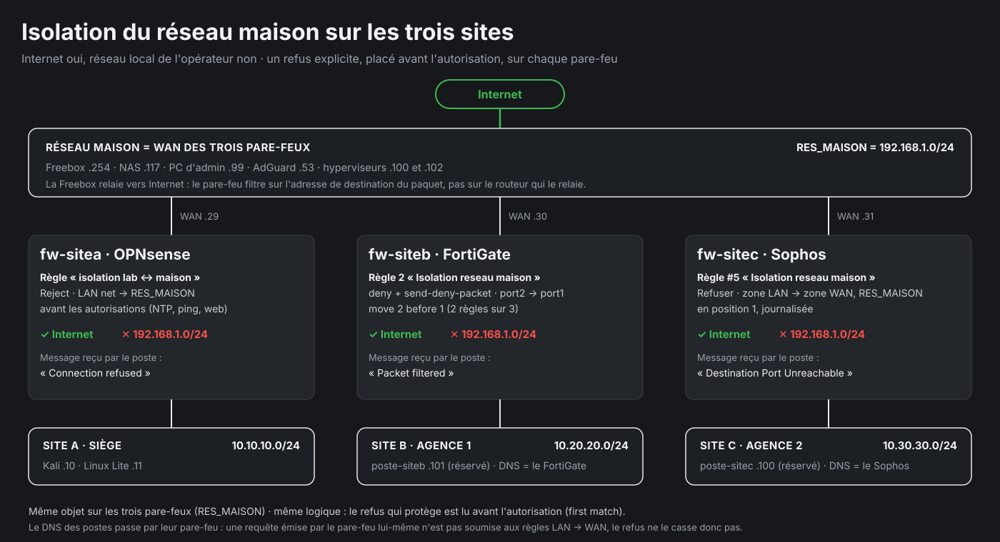
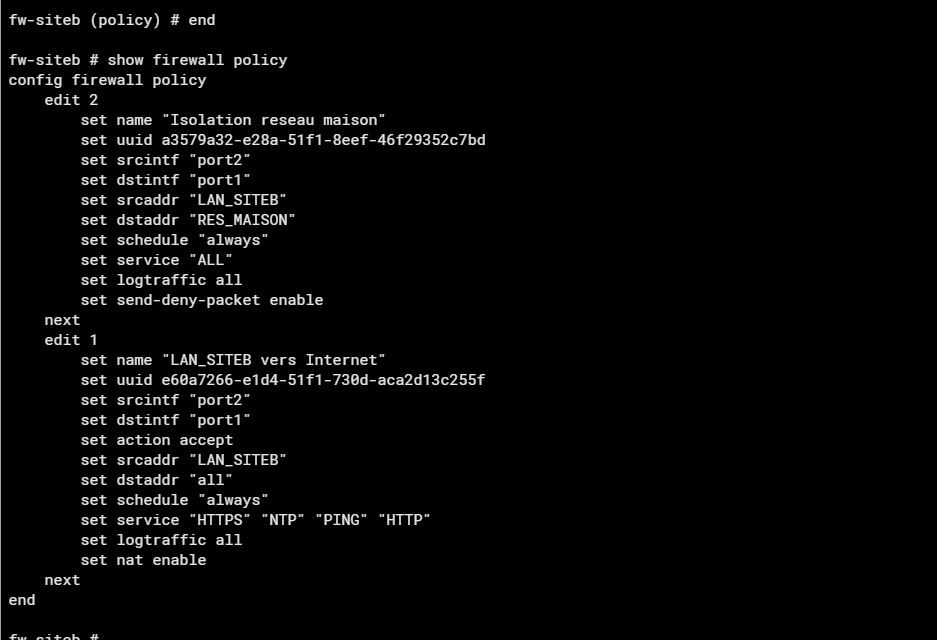
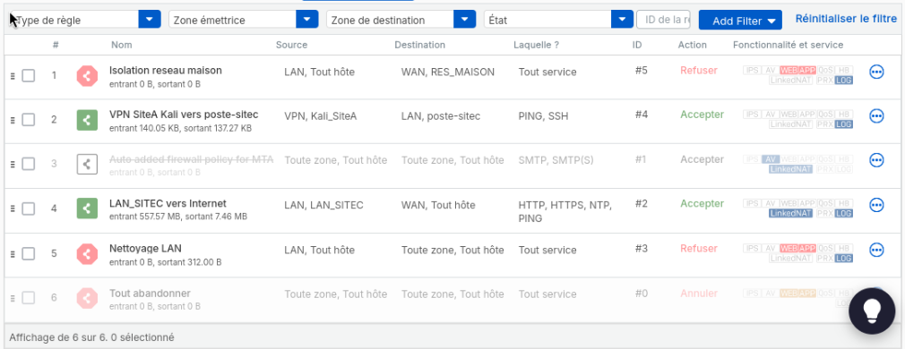
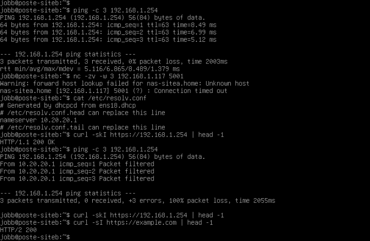
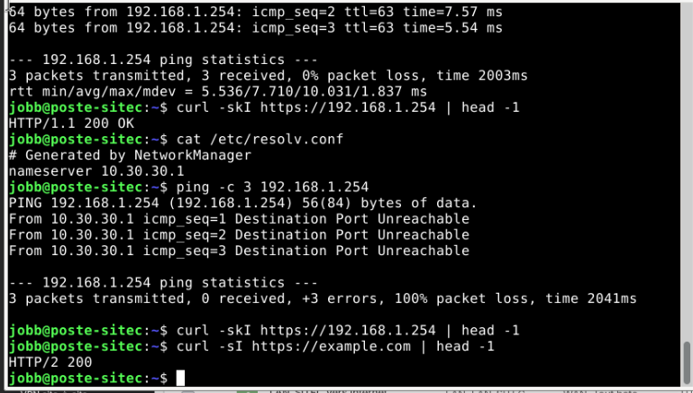
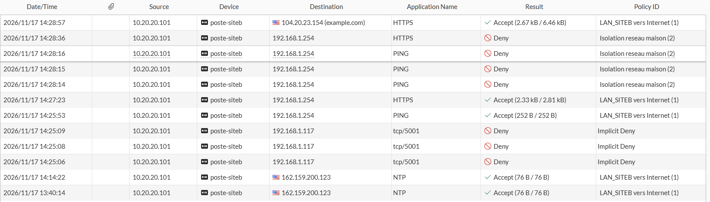
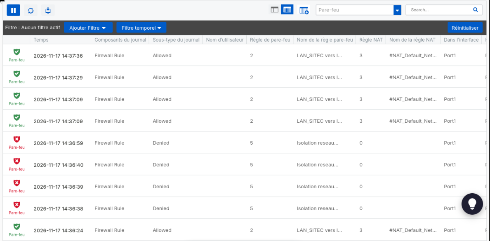

# 15 — Isoler le réseau maison sur les agences (sites B et C)

[← 14 · Règles dans le tunnel](14-regles-tunnel.md) · [Sommaire de la documentation](README.md) · [Annexe · Inventaire IP →](inventaire-ip.md)

> Date : 17 novembre 2026 · Site B : FortiGate (`fw-siteb`) · Site C : Sophos Firewall (`fw-sitec`) · plus deux finitions : le ping de diagnostic d'OPNsense et les réservations DHCP

## Objectif

Sur le site A, la règle « isolation lab ↔ réseau maison » ([fiche 08](08-filtrage-pare-feu.md)) empêche Kali d'atteindre la Freebox, le NAS ou le PC d'admin. Sur les sites B et C, rien de tel : leurs règles de sortie autorisaient le LAN vers **tout le WAN** (`all` chez Fortinet, « Tout hôte » chez Sophos), et ce WAN, c'est le **réseau maison** `192.168.1.0/24`. Un poste d'agence compromis pouvait rebondir vers la page d'administration de la box.

Chez un client, c'est le poste d'une agence qui joint la box et les équipements de l'opérateur. Objectif : **Internet oui, réseau local de l'opérateur non**, sur les trois sites.



**Le passage par la Freebox pour sortir sur Internet n'est pas bloqué** : un pare-feu filtre sur l'adresse de **destination** du paquet (par exemple celle d'un site web), pas sur le routeur qui le relaie.

## Avant de corriger : prouver la faille et vérifier le DNS

| Test depuis le poste de l'agence | Site B | Site C |
| --- | --- | --- |
| `ping 192.168.1.254` (Freebox) | ✅ passe, `ttl=63` | ✅ passe, `ttl=63` |
| `curl -skI https://192.168.1.254` (interface de la box) | ✅ `HTTP/1.1 200 OK` | ✅ `HTTP/1.1 200 OK` |
| `nc -zv 192.168.1.117 5001` (NAS) | bloqué | — |
| `cat /etc/resolv.conf` | `nameserver 10.20.20.1` | `nameserver 10.30.30.1` |

- **`ttl=63`** : un seul routeur traversé (le pare-feu de l'agence), le poste atteint directement le réseau maison.
- **Le NAS sur 5001 bloqué n'est pas une protection** : la règle de sortie du FortiGate n'autorise que HTTP, HTTPS, NTP et ping, et 5001 tombe dans le refus implicite. Tout ce qui écoute en 80 ou 443 dans la maison restait joignable.
- **Le DNS des postes est leur pare-feu.** C'est le pare-feu qui interroge AdGuard (`192.168.1.53`), et le trafic **émis par le pare-feu lui-même** n'est pas soumis aux règles LAN → WAN, qui ne filtrent que le trafic qui le **traverse**. Le refus vers `192.168.1.0/24` ne casse donc pas le DNS. Vérifié **avant** de poser la règle : si un poste avait interrogé AdGuard directement, l'isolation lui aurait coupé Internet.

## Site B : FortiGate (CLI)

```
config firewall address
    edit "RES_MAISON"
        set subnet 192.168.1.0 255.255.255.0
        set comment "Reseau maison = WAN du lab"
    next
end
config firewall policy
    edit 2
        set name "Isolation reseau maison"
        set srcintf "port2"
        set dstintf "port1"
        set action deny
        set srcaddr "LAN_SITEB"
        set dstaddr "RES_MAISON"
        set schedule "always"
        set service "ALL"
        set logtraffic all
        set send-deny-packet enable
    next
    move 2 before 1
end
```

- **`RES_MAISON`** : *address object*, l'équivalent de l'alias d'OPNsense. Même nom sur les trois pare-feux.
- **`send-deny-packet`** : par défaut, un *deny* FortiGate jette le paquet en silence (Drop). L'option renvoie un refus (Reject) : le poste échoue tout de suite.
- **`move 2 before 1`** : l'étape clé. FortiGate lit ses règles de haut en bas ; sans ce déplacement, la règle 1 (destination `all`) accepterait le trafic avant que le refus soit lu. C'est la **position** qui compte, pas le numéro : `show firewall policy` affiche les règles dans l'ordre d'évaluation (la 2, puis la 1).
- Licence d'évaluation : 2 règles sur les 3 autorisées.



## Site C : Sophos

- **Objet** *Hôte IP* `RES_MAISON`, type Réseau, `192.168.1.0/24`.
- **Règle #5 « Isolation reseau maison »** : position 1, action **Refuser**, journalisée ; zone LAN (source « Tous ») → zone WAN, `RES_MAISON`, tous services.

| Choix | Pourquoi |
| --- | --- |
| **Refuser** plutôt qu'**Abandonner** | « Refuser » renvoie un refus (Reject), « Abandonner » jette sans répondre (Drop). En interne, le refus accélère le diagnostic. |
| Source « Tous » plutôt que `LAN_SITEC` | Pour une règle de **refus**, une source large est préférable : une machine ajoutée plus tard sur le LAN, même hors de la plage prévue, est bloquée aussi. Pour une **autorisation**, c'est l'inverse. |
| Position 1 | Au-dessus de « LAN_SITEC vers Internet », dont la destination « Tout hôte » inclut la maison. La règle du tunnel (zone VPN) ne se chevauche pas avec celle-ci (zone LAN). |

**Autre méthode possible** : Sophos fournit des objets « Internet IPv4 (1-9) », « (11-126) »… qui couvrent Internet **sans** les plages privées, l'équivalent de `! RESEAUX_PRIVES` sur OPNsense, construit par liste plutôt que par exclusion. Les mettre en destination de la règle d'Internet aurait aussi corrigé la faille. Le refus explicite a été retenu parce qu'il est **journalisé** : chaque tentative vers la maison laisse une trace.



## Validation

| Test | Avant | Après (site B) | Après (site C) |
| --- | --- | --- | --- |
| Ping Freebox | passe | ❌ *Packet filtered* (de `10.20.20.1`) | ❌ *Destination Port Unreachable* (de `10.30.30.1`) |
| Interface web de la Freebox | `HTTP/1.1 200 OK` | ❌ pas de réponse | ❌ pas de réponse |
| Internet (`example.com`) | passe | ✅ `HTTP/2 200` | ✅ `HTTP/2 200` |





**Le journal du FortiGate raconte toute l'histoire** : le port 5001 refusé par l'*Implicit Deny*, le ping et le web vers la Freebox **acceptés par la règle 1** (la faille), puis **refusés par la règle 2** après la correction, et `example.com` toujours accepté.





**Trois constructeurs, trois façons de dire non :**

| Pare-feu | Réglage | Message reçu par le poste |
| --- | --- | --- |
| OPNsense | Reject | *Connection refused* |
| FortiGate | deny + `send-deny-packet` | *Packet filtered* (ICMP « interdit par l'administrateur ») |
| Sophos | Refuser | *Destination Port Unreachable* |

Reconnaître le message aide à savoir **qui** bloque chez un client qui a plusieurs constructeurs.

## Deux finitions

### Le ping de diagnostic d'OPNsense, limité à Internet

La règle « Ping de diagnostic » ([fiche 10](10-liste-blanche.md)) autorisait le lab à pinguer **n'importe où**, donc aussi les agences à travers le tunnel. Sa destination est maintenant `! RESEAUX_PRIVES`, comme la règle web ([fiche 14](14-regles-tunnel.md)). Les exceptions précises, placées au-dessus (Kali → Freebox, Kali → `poste-sitec`), restent valables. Vérification depuis Kali : `ping 10.30.30.100` passe (règle du tunnel), `ping 1.1.1.1` passe (Internet).

Effet de bord connu : le ping de la passerelle `10.10.10.1` (OPNsense lui-même, adresse privée) est aussi refusé. Une règle dédiée (*LAN net → LAN address*, ICMP) le rétablit si besoin.

### Les réservations DHCP

Les règles visent désormais des adresses précises : elles ne doivent plus changer.

- **FortiGate** : réservation `10.20.20.101` pour `poste-siteb` dans le serveur DHCP de `port2` (le serveur `fortilink`, créé par défaut pour les FortiSwitch, n'est pas concerné). `execute dhcp lease-list` montre aussi un ancien bail en `.100` pour la même adresse MAC, avec l'identifiant `d-i` : celui de l'installateur Debian, sans conséquence.
- **Sophos** : il **refuse** une adresse réservée **dans** la plage dynamique, là où le FortiGate l'accepte. La plage est passée de `.100–.200` à `.101–.200`, et `10.30.30.100` est réservée pour `poste-sitec` : l'objet et la règle du tunnel n'ont pas eu à changer. Vérifié par un nouveau bail (`nmcli device disconnect/connect`).

## Pièges rencontrés et corrections

- **Journal du FortiGate vide** : la période affichée était de 5 minutes, les tests dataient de 10 minutes. Passée à 1 heure.
- **Règle Sophos créée sans journalisation** : case cochée avant d'enregistrer.
- **Réservation refusée par le Sophos** (adresse dans la plage dynamique) : plage réduite d'une adresse plutôt que de changer l'IP visée par les règles.
- **Capture du tableau de bord FortiGate non publiée** : on y voyait le numéro de série.

## Ce qu'il faut retenir

« any », « all », « Tout hôte » couvrent toujours plus que ce qu'on croit : le réseau de l'opérateur côté WAN, les autres sites côté tunnel. La même faille a été trouvée et corrigée trois fois ([fiche 14](14-regles-tunnel.md) et cette fiche), avec la même méthode : prouver la faille, vérifier ce qui pourrait casser (ici le DNS), poser un refus **avant** l'autorisation, puis tester dans les deux sens.

## Suite

- WAN des agences dans un VLAN séparé, pour un vrai lien routé entre les sites.
- Enregistrements DNS `home.arpa` pour chaque équipement.
- VPN d'accès distant sur le Sophos (Sophos Connect) avec double authentification.

---

[← 14 · Règles dans le tunnel](14-regles-tunnel.md) · [Sommaire de la documentation](README.md) · [Annexe · Inventaire IP →](inventaire-ip.md)
